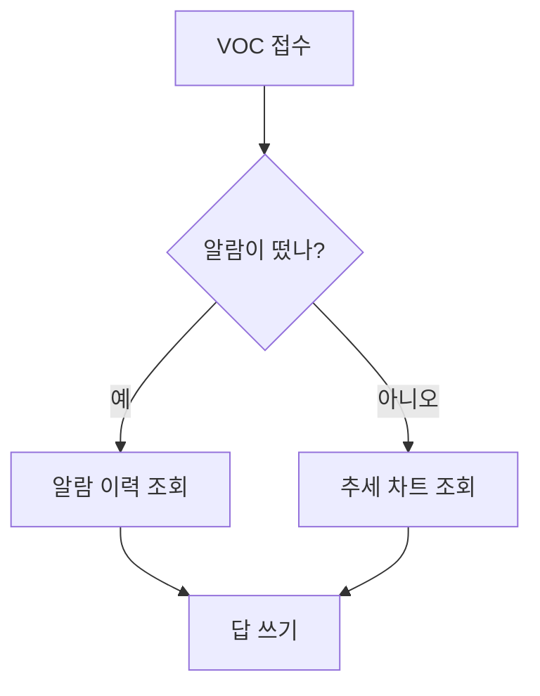
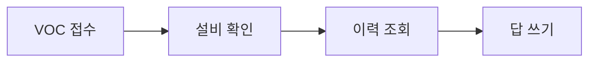
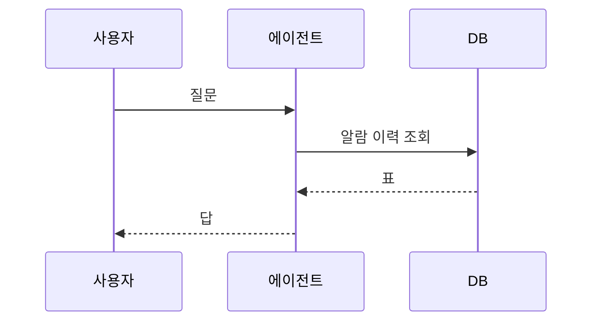
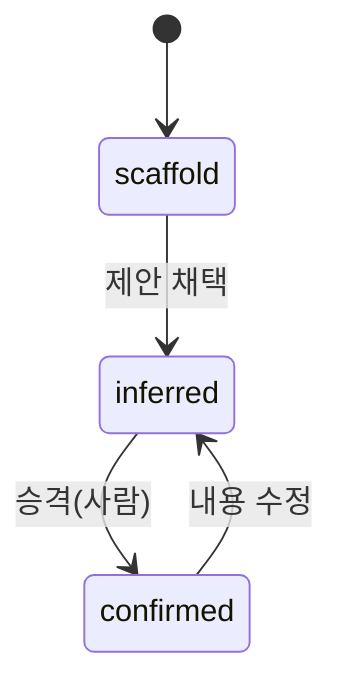
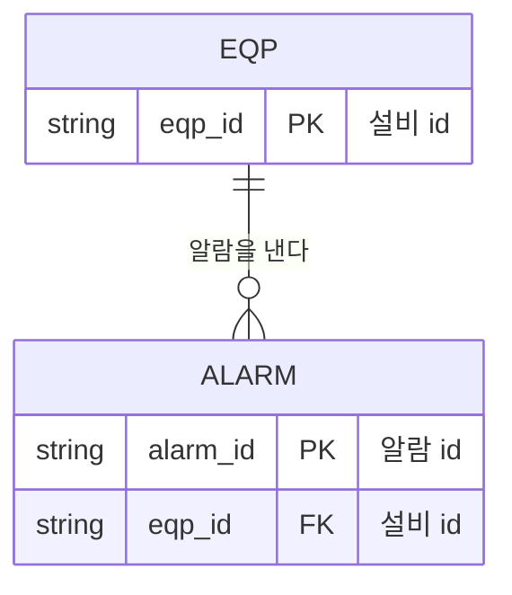
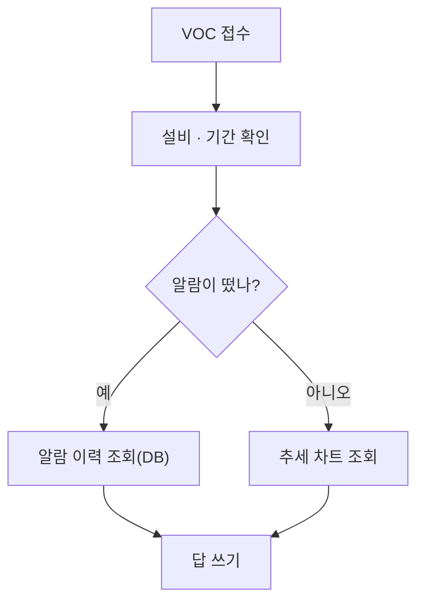
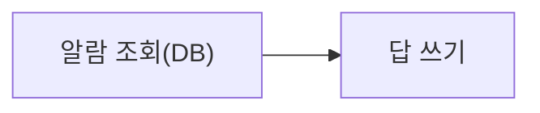
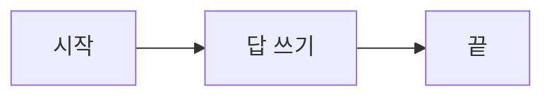
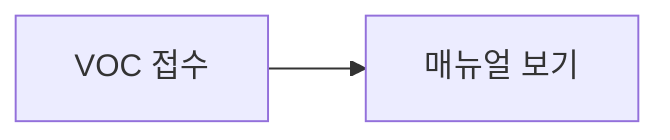

# akg-mermaid

AKG md 문서 안에 mermaid 그림을 **쓰는** 쪽이다. 올리기는 [`akg-push`](../akg-push/SKILL.md),
가져오기는 [`akg-pull`](../akg-pull/SKILL.md) 이 한다.

AKG 의 근거 파일(레포 [ollybaysion/agent-knowledge-governance](https://github.com/ollybaysion/agent-knowledge-governance)):

- `docs/agent-knowledge-governance-json-spec.md` 의 "md 안의 mermaid 펜스" 문단: 모든 md 타입에서
  펜스를 그림으로 그린다. 원문은 글자로 저장한다.
- `public/js/mermaid-frame.mjs`: mermaid 설정(`securityLevel: "strict"` · `theme: "base"` ·
  `htmlLabels: false`).
- `public/lib/mermaid-src.mjs`: 펜스 판정 `isMermaid` · 오류 줄 `mermaidError` · 테마 `mermaidTheme`.
- `public/lib/md-parse.mjs`: 펜스 줄 규칙 `FENCE`.
- `public/vendor/mermaid/mermaid.min.js`: 배포본 11.17.2.

다른 그림 스킬과 나누는 법:

- [`svg-diagram`](../svg-diagram/SKILL.md) 은 HTML 문서 · Artifact · README 에 넣는 SVG 를
  스펙 → 생성기로 만든다. AKG md 는 글자만 저장하고 mermaid 펜스만 그림으로 그린다.
  그래서 AKG 문서 안 그림은 이 스킬이, AKG 밖 문서의 그림은 svg-diagram 이 맡는다.
- [`analysis-flow`](../analysis-flow/SKILL.md) 는 데이터 분석 과정(출처 · 쿼리 · 단계)을
  물어 모으고 svg-diagram 으로 그린다. 분석 과정 그림을 AKG 밖 문서에 넣을 때 쓴다.
- [`fdc-flowchart`](../fdc-flowchart/SKILL.md) 는 FDC 에이전트 md 의 `## 데이터` 플로우 펜스를 쓴다.
  BE 가 그 펜스를 실행하므로 BE 문법이 먼저다. 이 스킬의 라벨 규칙(큰따옴표 · 크기 상한)과 부딪치는 곳은 그 스킬을 따른다.

## 1. 언제 쓰나

AKG md 문서 안에서 다음 넷을 보일 때 쓴다.

- 흐름: 단계의 순서.
- 판단 분기: 조건에 따라 갈리는 길.
- 주고받기: 참여자 사이의 요청 · 응답 순서.
- 상태 전이: 상태와 상태를 잇는 사건.

규칙: 그림이 보이는 사실은 본문 글에도 적는다.
AKG 는 펜스 원문을 글자 그대로 `markdown` 에 저장한다. 렌더 산출물과 BE · LLM 에도 글자로 간다.
그림은 AKG 화면에서만 생긴다. 본문 글에 같은 사실이 있으면 화면 밖에서도 뜻이 같다.

## 2. 어디에 두나

1. 절(`## …`) 본문 안에 펜스를 둔다.
2. 펜스 바로 앞에 그림을 한 줄로 설명하는 문장을 쓴다.
3. 여는 줄은 줄 맨 앞에 ```` ```mermaid ```` 만 쓴다. AKG 의 `FENCE` 는 줄 맨 앞에서
   시작하고 언어 이름 하나로 끝나는 줄만 펜스로 본다. 목록 안에 들여 쓴 펜스는 글자로 보인다.
4. 닫는 줄은 여는 줄과 같은 수의 ```` ``` ```` 로 쓴다.

## 3. 쓸 그림 종류

기본은 다음 다섯이다. 표본은 표 아래에 있다.

| 첫 줄 | 쓰는 때 |
| --- | --- |
| `flowchart TD` | 단계 순서와 판단 분기. 위에서 아래로. 흐름 그림의 기본 |
| `flowchart LR` | 가로 4 단 이하의 짧은 흐름. 왼쪽에서 오른쪽으로 |
| `sequenceDiagram` | 참여자 사이의 요청 · 응답 순서 |
| `stateDiagram-v2` | 상태와 전이. AKG 설계 문서의 슬롯 전이 그림이 이 종류다 |
| `erDiagram` | 표 사이의 관계(db-schema 문서) |

`flowchart TD`:



`flowchart LR`:



`sequenceDiagram`:



`stateDiagram-v2`:



`erDiagram`:



11.17.2 배포본은 다음 종류도 그린다(2026-10-27, check.mjs 로 작은 표본을 그려 확인).
`classDiagram` · `gantt` · `pie` · `journey` · `gitGraph` · `mindmap` · `timeline` ·
`quadrantChart` · `xychart-beta` · `sankey-beta` · `block-beta` · `packet-beta` ·
`architecture-beta` · `kanban` · `requirementDiagram` · `C4Context` · `radar-beta` · `treemap-beta`.
이 가운데 `gantt` · `timeline` · `packet-beta` · `C4Context` · `treemap-beta` 는 작은 표본도
폭이 720px 를 넘었다. 이 종류는 check.mjs 의 폭 주의를 보고 쓴다.

## 4. AKG 에서 지킬 문법

AKG 는 숨은 틀 `/mermaid-frame.html` 에서 다음 설정으로 그린다: `securityLevel: "strict"`,
`theme: "base"`, `htmlLabels: false`. 색 · 글꼴은 페이지 색 토큰에서 온다(`mermaidTheme`).
라이트 · 다크를 바꾸면 그림을 다시 그린다.

문법마다 AKG 화면에서 보이는 것(check.mjs 로 그려 확인):

| 쓴 것 | AKG 화면 | 쓰는 꼴 |
| --- | --- | --- |
| `click a "https://…"` | 그림 자리에 오류 "SVG 를 읽지 못했습니다" | click 줄을 지운다. 링크는 본문 글에 둔다 |
| `click a 함수이름` | 그림은 그려진다. click 은 strict 가 끈다 | click 줄을 지운다 |
| `a["<b>굵게</b>"]` 같은 HTML 태그 | 태그가 글자 그대로 보인다 | 마크다운 문자열 ``a["`**굵게** 글`"]`` |
| `a["줄<br>바꿈"]` | 줄이 바뀐다 | 그대로 쓴다 |
| `style` · `classDef` · `class` · `:::` · `linkStyle` | 색이 `!important` 로 박힌다. 다크 화면에서도 그 색이 남는다 | 줄을 지운다. 색은 AKG 테마가 정한다 |
| `%%{init: …}%%` | 그 그림만 지시문의 테마로 그려진다 | 줄을 지운다 |
| 펜스 안 `[[id]]` | 글자로 남는다. links[] 는 펜스 밖의 `[[ ]]` 만 모은다(`src/wikilinks.mjs`). flowchart 에서는 parse error | 링크는 펜스 앞뒤 본문 글에 둔다 |
| 라벨 안 `#quot;` | `&quot;` 가 글자로 보인다 | 인용은 작은따옴표 `'예'` 로 쓴다 |

노드 id 와 라벨:

- 노드 id 는 영문 소문자 낱말로 쓴다: `voc` · `alarm` · `check_hist`.
  `end` 는 mermaid 예약어라서 id 로 쓰면 parse error 가 난다. `done` 처럼 다른 낱말을 쓴다.
- 라벨은 한국어로 `[…]` · `{…}` 안에 쓴다.
- 괄호 · `·` · `:` · `/` · `#` 같은 기호가 든 라벨은 큰따옴표로 싼다: `a["조회(DB)"]`.
  괄호는 큰따옴표가 없으면 parse error 다. `·` · `:` 는 지금 그려지지만 같은 꼴로 맞춘다.
- 화살표 라벨은 `a -->|예| b` 로 쓴다.

크기:

- 한 그림에 **노드 8 개 · 화살표 10 개 이하**.
- 근거 하나: AKG 읽기 칸의 최대 폭은 720px 다(`ui.css` 의 `.cols > .main`). 더 넓은 그림은
  칸에 맞춰 줄고 글자도 작아진다.
- 근거 둘: 1440×900 화면에서 머리 띠를 빼면 그림이 보이는 높이는 약 800px 다.
- 근거 셋: AKG 와 같은 글꼴 · 14px 로 그려 잰 값(check.mjs).

  | 그림 | 크기 | 판정 |
  | --- | --- | --- |
  | `flowchart TD` 노드 8 · 화살표 8 · 7 단 | 356×765px | 한 화면에 들어간다 |
  | `flowchart TD` 노드 12 · 화살표 13 · 10 단 | 416×1177px | 높이가 넘친다 |
  | `flowchart LR` 일렬 노드 5 | 794×66px | 폭이 넘친다. LR 은 가로 4 단까지 |
  | `sequenceDiagram` 참여자 4 | 850×523px | 폭이 넘친다. 참여자 한 명이 200px 라서 3 명까지 |

- 상한을 넘으면 그림을 둘로 나눈다. 그림마다 앞에 설명 문장을 둔다.

## 5. 올리기 전 확인

추천 방법은 이 스킬의 [`check.mjs`](check.mjs) 다.

- 하는 일: md 의 mermaid 펜스를 AKG 와 같은 배포본 · 같은 설정으로 headless Chrome 에서 그린다.
  설정은 strict · base · htmlLabels false · AKG 글꼴 14px 다.
- AKG 와 같은 SVG 읽기 검사도 한다. 그래서 링크 click 같은 "SVG 를 읽지 못했습니다" 도 잡는다.
- 폭 720px · 높이 800px 를 넘는 그림과 4절 표의 문법 줄에 주의를 낸다.
- 필요한 것: `node`, Chrome(`google-chrome` · `chromium`. 다른 이름은 `CHROME=<실행 파일>`),
  AKG 체크아웃 `~/work/fdc-agent/agent-knowledge-governance`([`setup`](../setup/SKILL.md) 5절).
  배포본이 다른 곳에 있으면 `--mermaid <mermaid.min.js>` 로 준다.

```bash
node "<이 스킬 폴더>/check.mjs" 문서.md
```

출력 예(펜스 둘. 첫 펜스에 괄호 라벨과 링크 click 이 있다. `Expecting` 줄은 줄였다):

```text
FAIL  문서.md:7 도식 1 9 줄(도식 2 줄): Parse error
      ...art LR  query[알람 조회(DB)] --> answer[답 쓰
      ----------------------^
      Expecting 'SQE', 'DOUBLECIRCLEEND', 'PE', … got 'PS'
  주의 10 줄(도식 3 줄): click 줄은 지운다(링크 click 은 AKG 에서 그림을 깨뜨린다). 링크는 본문 글에 둔다
ok    문서.md:17 도식 2 (stateDiagram, 84×226px)
그리지 못한 펜스 1 개 · 주의 1 개
```

`ok` 줄의 괄호는 그림 종류와 크기다.

끝 코드:

| 코드 | 뜻 |
| --- | --- |
| 0 | 모든 펜스가 그려졌다. 주의 줄은 있을 수 있다 |
| 1 | 그리지 못한 펜스가 있다(`FAIL` 줄) |
| 2 | 준비 문제: 파일 · 배포본 · Chrome 을 찾지 못했다 |

절차:

1. md 파일을 쓴다.
2. `check.mjs` 를 돌린다.
3. `FAIL` 줄을 6절대로 고친다.
4. `주의` 줄을 4절대로 고친다.
5. 끝 코드 0 · 주의 0 이 될 때까지 2~4 를 되풀이한다.
6. [`akg-push`](../akg-push/SKILL.md) 3절의 절차로 올린다(`--dry-run` 먼저).

고른 이유: node 에서 `mermaid.parse` 만 부르는 길은 flowchart · stateDiagram 에서
`addHook is not a function` 으로 멈춘다(mermaid 가 쓰는 DOMPurify 가 DOM 을 찾는다).
AKG 서버의 읽기 화면을 여는 길은 로그인 · 문서 만들기가 앞에 선다. check.mjs 는 같은 배포본 ·
같은 설정을 로컬 Chrome 에서 돌려 같은 판정을 낸다.

## 6. 오류 읽기

AKG 는 오류 줄 첫머리에 줄 번호를 적는다(`mermaidError`).

| 자리 | 첫머리 | 줄 번호의 뜻 |
| --- | --- | --- |
| 읽기 화면 | `도식 N 줄: Parse error` | 펜스 안 도식 줄. 여는 펜스 다음 줄이 1 |
| 절 편집기의 미리보기 | `N 줄: Parse error` | 문서 줄 = 여는 펜스 줄 + 도식 줄. 첫 `##` 앞 머리 글의 그림은 읽기 화면과 같은 `도식 N 줄` |
| check.mjs | `<문서 줄> 줄(도식 N 줄)` | 둘 다. 문서 줄은 akg push 로 올리는 md 파일의 줄이다 |

- mermaid 가 글 끝 다음 줄을 가리키면 AKG 는 마지막 줄로 맞춘다. check.mjs 도 같다.
- 닫지 않은 괄호는 그다음 줄을 가리킬 때가 많다. 가리킨 줄의 앞 줄도 본다.
- 첫머리 아래 줄은 mermaid 의 위치 표시(`---^`)와 기대한 낱말(`Expecting …`)이다.
  읽기 화면은 그 아래에 펜스 원문도 보인다.
- `SVG 를 읽지 못했습니다` 는 mermaid 가 그린 SVG 를 AKG 가 읽지 못했다는 뜻이다.
  지금 아는 원인은 링크 click 하나다.

## 7. 표본

좋은 표본: 절 하나에 설명 문장 · 그림 · 같은 사실의 본문 글.

````markdown
## 처리 흐름

VOC 를 받아 알람 여부로 갈라 조회하고 답을 쓰는 흐름이다.



1. VOC 의 설비와 기간을 확인한다.
2. 그 기간에 알람이 떴으면 알람 이력을 DB 에서 조회한다.
3. 알람이 없으면 추세 차트를 조회한다.
4. 조회 결과로 답을 쓴다.
````

흔한 실수 셋과 고친 꼴이다. 이 파일에 check.mjs 를 돌리면 틀린 꼴 셋이 `FAIL` 로 나온다.

실수 하나: 괄호가 든 라벨을 큰따옴표 없이 쓴다. 읽기 화면에 `도식 2 줄: Parse error`.

```mermaid
flowchart LR
  query[알람 조회(DB)] --> answer[답 쓰기]
```

고친 꼴:



실수 둘: 예약어 `end` 를 노드 id 로 쓴다. 읽기 화면에 `도식 3 줄: Parse error`.

```mermaid
flowchart LR
  start[시작] --> answer[답 쓰기]
  answer --> end
```

고친 꼴:



실수 셋: 링크를 click 으로 단다. 읽기 화면에 `SVG 를 읽지 못했습니다`.



고친 꼴(링크는 펜스 앞뒤 본문 글에 둔다):


