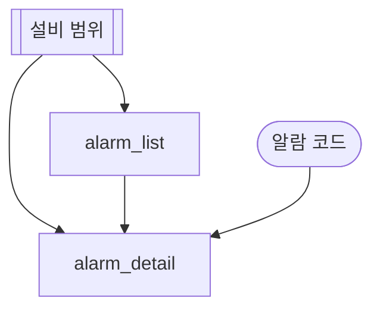
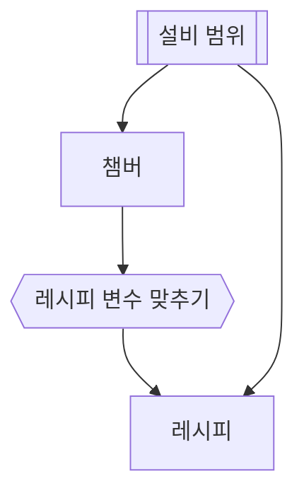
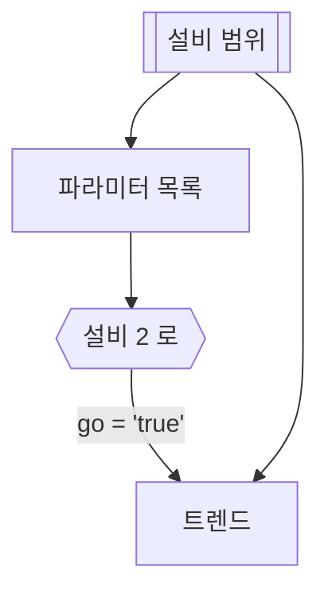
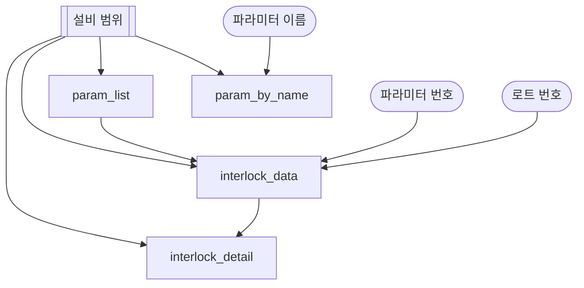
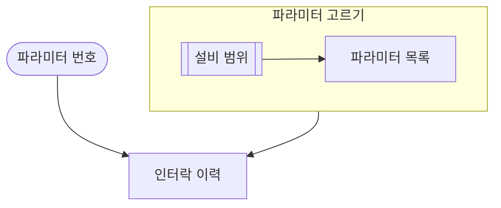
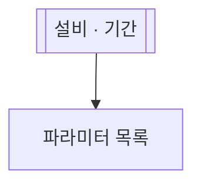
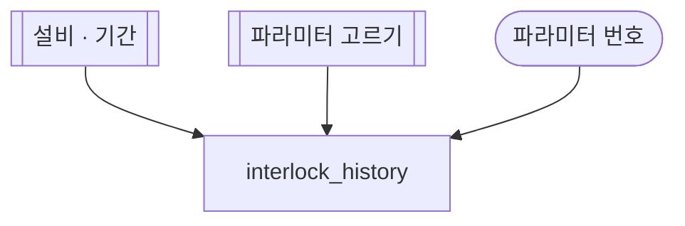
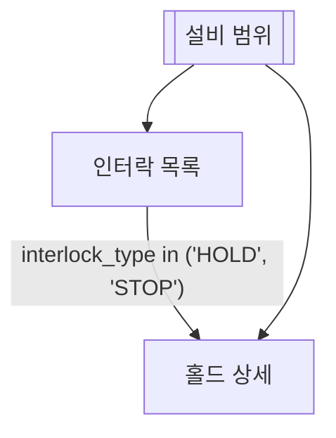
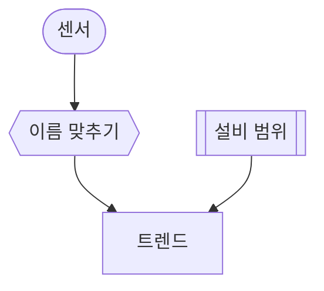
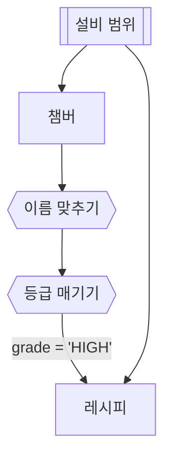

# fdc-agent-md

FDC 에이전트 md 한 장을 처음부터 AKG 등록까지 맡는다.
에이전트 md 는 AKG 문서 타입 `domain-skill` 의 본문이다. BE 가 이 md 를 읽어 에이전트 하나로 등록한다.
`## 데이터` 아래의 mermaid 펜스는 **플로우 펜스**다. BE 가 이 펜스를 실행 그래프로 컴파일한다.

근거 파일:

- BE 레포 [ollybaysion/fdc-agent-be-spring](https://github.com/ollybaysion/fdc-agent-be-spring)
  (로컬 체크아웃 `~/work/fdc-agent/fdc-agent-be`):
  - `docs/skill-md.md`: 절 구조 · 에이전트 키 · 조각 · 데이터 · 플로우 · 검사 도구 · 공통 md.
  - `src/main/java/fdc/agent/knowledge/tools/markdown/SkillMarkdownTool.java`: 받는 절 · 읽기 거부 글.
  - `src/main/java/fdc/agent/knowledge/tools/flow/`: `FlowGrammar`(줄 정규식) · `FlowCompiler`(노드 종류 · subgraph) ·
    `FlowRules`(뜻 검사) · `FlowError`(오류 코드) · `CheckFlow`(검사 도구) · `ConvertAskToFlow`(옮김 규칙) ·
    `FlowMaps`(map 항목 검사) · `MapExprParser`(변환 식 문법).
  - `src/main/java/fdc/agent/common/domain/MapExpr.java`: 변환 식 셈 규칙. 변환 표본은 `src/test/resources/map-node/`.
  - `scripts/check-flow` · `scripts/convert-ask-to-flow` · `scripts/reload.sh`.
- AKG 레포 [ollybaysion/agent-knowledge-governance](https://github.com/ollybaysion/agent-knowledge-governance)
  (로컬 체크아웃 `~/work/fdc-agent/agent-knowledge-governance`):
  - `schemas/domain-skill/v1.schema.json`(body `{ name, markdown }`) · `src/envelope.mjs`(봉투 칸 · role).
  - `server/routes/docs.mjs`(저장 · 켜기 · role 검사) · `src/flow/agent-md.mjs`(BE 와 같은 플로우 검사) ·
    `src/flow/flow-maps.mjs` · `src/flow/map-expr.mjs`(map 항목 · 변환 식 문법).
  - `bin/akg.mjs`(`akg push`) · `docs/consuming.md`.

BE 의 코드 이름 · 메시지는 "흐름" 이라고 적는다. 이 스킬의 "플로우" 와 같은 것이다.

## 1. 할 일 셋

| 할 일 | 따라갈 절 |
| --- | --- |
| 새 에이전트 md 만들기 | 2 준비 → 3 틀(빈 틀 표본 복사) → 4~7.1 데이터 절 · 플로우 · 변환 노드 → 8 쓰는 순서 → 9 검사 → 10 AKG 등록 |
| 옛 md 옮기기(ASK 항목 · `@묶음`) | 2 준비 → 11 옮기기 절차 → 9 검사 → 10 AKG 등록 |
| 고치고 검증하기 | 9 검사 → 12 오류 코드 · 거부 글 → 4~7.1 에서 규칙 확인 → 10 AKG 수정 |

다른 스킬과 나누기:

| 할 일 | 스킬 |
| --- | --- |
| 에이전트 md 를 쓰고 · 옮기고 · 검사하고 · AKG 에 등록한다 | 이 스킬 |
| AKG md 의 설명 그림(실행하지 않는 그림)을 쓴다 | [`akg-mermaid`](../akg-mermaid/SKILL.md) |
| AKG 에 붙는 토큰 · `akg` CLI 전반(슬롯 제안 · 표 카탈로그 포함) | [`akg-push`](../akg-push/SKILL.md) |

akg-mermaid 의 일반 규칙과 BE 문법이 부딪치면 이 스킬은 BE 문법을 따른다. 부딪치는 곳은 6절 끝에 있다.

## 2. 사내에서 쓸 때 준비

| 준비 | 쓰는 곳 | 확인 |
| --- | --- | --- |
| BE 체크아웃(origin/main). 셸 변수 `FDC_BE` 로 가리킨다 | `scripts/check-flow` · `scripts/convert-ask-to-flow` · `scripts/reload.sh` | `ls "$FDC_BE/scripts/check-flow"` |
| JDK 21. `JAVA_HOME` 으로 준다 | 위 두 BE 스크립트(gradle 로 돈다. 첫 실행은 BE 를 빌드한다) | `"$JAVA_HOME/bin/java" -version` 가 21 |
| AKG 체크아웃(origin/main). 셸 변수 `AKG_DIR` 로 가리킨다 | `check.mjs` 의 mermaid 배포본 · node 플로우 검사(9절) · `akg` CLI | `ls "$AKG_DIR/src/flow/agent-md.mjs"` |
| headless Chrome(`google-chrome` · `chromium`, 다른 이름은 `CHROME=`) | akg-mermaid 의 `check.mjs` | `node check.mjs` 가 끝 코드 2 를 내지 않는다 |
| AKG 주소 `AKG_SERVER` 와 토큰 `AKG_TOKEN` | `akg push` · API 길(10절) | [`akg-push`](../akg-push/SKILL.md) 1절 절차 |

```bash
FDC_BE="${FDC_BE:-$HOME/work/fdc-agent/fdc-agent-be}"
AKG_DIR="${AKG_DIR:-$HOME/work/fdc-agent/agent-knowledge-governance}"
export JAVA_HOME="${JAVA_HOME:-$HOME/tools/jdk-21.0.11+10}"
```

준비가 빠졌을 때 하는 일:

| 빠진 것 | 하는 일 |
| --- | --- |
| BE 체크아웃 또는 JDK 21 | 플로우 검사는 AKG 체크아웃의 node 한 줄로 돌린다(9절). 같은 줄 꼴을 낸다. 옮기기는 11절 대응표대로 손으로 한다 |
| BE · AKG 체크아웃 둘 다 | AKG 저장 검사로 확인한다. 초안으로 올리고 켤 때 오류를 받는다(10절). AKG 편집기도 저장 전에 같은 검사를 보인다 |
| Chrome | AKG 읽기 화면이나 편집기 미리보기에서 그림을 본다. 틀린 펜스는 그 자리에 오류 줄을 보인다 |
| `akg` CLI | 10절의 API 길로 올린다 |

## 3. 에이전트 md 전체 틀

### 절

md 한 장이 에이전트 하나다. 절은 아래 순서로 쓴다. 이름 끝의 `?` · `:` 는 BE · AKG 가 걷고 맞춘다.

| 줄 · 절 | 뜻 |
| --- | --- |
| `# 제목` | FE 에 보이는 에이전트 이름. 첫 `#` 줄 하나 |
| `## 한 줄 설명` | `summary`. 사람이 카탈로그에서 고를 때 본다. AKG SKILL.md 의 description 도 이 첫 문단이다 |
| `## 언제 호출되는가?` | `description`. 줄마다 상황 하나를 사람 말투로 적는다. 예: `인터락이 났는데 왜 났는지 모르겠다.` FE 는 첫 줄을 카드에 보인다 |
| `## 도메인 지식` | 본문 있는 소제목 하나가 지식 조각 하나다. 조각 id 는 `md이름/소제목 경로` 다 |
| `## 데이터` | md 하나에 하나. 플로우 펜스 하나 + `### id — 제목` 데이터 항목들(SQL 항목 · map 항목, 4절) |
| `## 답변 품질 검증 Set` | main md 만. 답 검증 질문이다. AKG 의 검증 Set 화면이 쓴다 |

- 절은 빠져도 된다. 예: 공통 md `eqp-scope` 는 제목 · 한 줄 설명 · 데이터 셋이다.
- md 원문 전체도 모델에게 그대로 간다.
- `##` 절 이름은 위 다섯만 쓴다. BE 는 다른 이름의 `##` 절을 읽지 않고 원문에만 둔다.
  AKG 의 절 편집기 · 검증 Set 저장은 그 md 에서 `모르는 절입니다 — "## 메모"` 로 멈춘다(422 `unsplittable_markdown`).

`## 데이터` 의 데이터 항목은 두 종류다. 항목 안의 펜스 언어가 종류를 정한다.

| 항목 | 펜스 | 플로우 노드 | 하는 일 |
| --- | --- | --- | --- |
| SQL 항목 | ```` ```sql ```` 하나 | 조회 `id[글]` | SQL 을 돌려 표를 낸다 |
| map 항목 | ```` ```map ```` 하나 | 변환 `id{{글}}` | 앞 노드의 값 이름을 바꾸고 식을 셈한다(7.1절) |

1. 절 아래 첫 제목은 `###` 다. `### id — 제목` 하나가 데이터 항목 하나다.
2. id 는 `[A-Za-z][A-Za-z0-9_]*` 다. SQL 항목과 map 항목이 한 id 풀을 쓴다. 등록된 md 전체에서 하나뿐이다.
   SQL 항목 id 는 모델이 부르는 이름이고 조회 주소다.
3. 대시는 `—` · `–` · `-` 를 받는다. 대시 양쪽에 공백을 둔다.
4. 본문은 펜스 하나와 산문이다. 산문은 그 항목의 설명이다. map 항목에는 map 펜스 하나만 둔다(`MAP_FENCE`).
5. 항목 안의 `####` 는 그 항목의 본문이다.
6. 사람에게 받을 값은 플로우 펜스의 입력 노드 `id([글])` 로 적는다. ```` ```ask ```` 펜스 · `@묶음` 은 거부된다(12절).

### md 이름

md 이름 = AKG 문서 id = body `name` = check-flow 에 넘기는 파일 이름(확장자 뺌)이다. BE 에서 에이전트의 키다.

- AKG 꼴 `^[a-z][a-z0-9-]*$`: 영문 소문자로 시작하고 소문자 · 숫자 · `-` 만 쓴다. `_` 는 쓰지 않는다.
- 플로우 노드 꼴: `-` 는 글자 사이에 하나씩 둔다. 첫 `-` 앞 낱말은 mermaid 낱말(`end` · `style` · `class` · `subgraph` …)이 아니다.
- 조회 id · subgraph id 는 `_` 를 쓴다. 그래서 md 이름과 표기로 갈린다.

### main 과 sub

봉투 칸 `role` 이 정한다. 칸이 없으면 main 이다.

| role | 뜻 | 예 |
| --- | --- | --- |
| `main` | 에이전트가 되는 md. 사람 · 모델이 고르는 에이전트 후보에 든다. 검증 Set 은 main 에만 둔다 | `interlock-param` |
| `sub` | 다른 md 가 플로우 노드 `md이름[[글]]` 로 앞에 세우는 md. 에이전트 후보에 들지 않는다. BE 는 그 md 의 입력 노드 · 조회를 세운 쪽 에이전트에 싣는다 | 공통 md `eqp-scope` |

### 빈 틀 표본

복사해서 쓴다. 제목 · 설명 · 조각 · 조회 id · SQL · 입력 노드를 바꾼다.
이 표본은 2026-10-28 BE main 의 check-flow 로 `OK` 다.

````markdown
# 알람 이력 에이전트

## 한 줄 설명

설비의 알람 이력과 알람 상세를 기간으로 조회한다.

## 언제 호출되는가?

이 설비에 알람이 왜 떴는지 모르겠다.
지난주에 뜬 알람을 다 보고 싶다.

## 도메인 지식

### 알람 등급

- A 등급은 설비를 멈춘다. B 등급은 경고만 낸다.

## 데이터



입력 `alarm_code` 는 상세를 볼 알람 코드다(예: A-102). 값이 없으면 알람 목록에서 고른다.

### alarm_list — 알람 목록

```sql
select alarm_code, alarm_name, act_time from ALARM_HIST where eqp_id = :eqp_id and act_time between :start_time and :end_time
```

### alarm_detail — 알람 상세

```sql
select alarm_code, cause, action from ALARM_DETAIL where eqp_id = :eqp_id and alarm_code = :alarm_code
```
````

- `:eqp_id` · `:start_time` · `:end_time` 은 `eqp-scope` 가 채운다.
- `alarm_detail` 의 `:alarm_code` 는 입력 `alarm_code` 또는 `alarm_list` 의 열이 채운다. 목록이 3 행 이상이면 BE 가 행 고르기 카드를 낸다.
- 입력 노드의 예 값 · 뜻은 펜스 아래 본문 글에 적는다. 입력 노드 글은 짧은 이름이다.

## 4. 데이터 절 · 플로우 펜스의 자리

1. `## 데이터` 절은 md 하나에 하나다.
2. 플로우 펜스는 `## 데이터` 제목 아래, 첫 `###` 항목 앞에 둔다.
3. 펜스는 md 하나에 하나다.
4. 펜스 첫 줄은 `flowchart TD` 다. 가로로 그리려면 `flowchart LR` 이다.
5. 펜스 아래 · 첫 `###` 앞에 입력 노드를 설명하는 본문 글을 둘 수 있다.

`:var` 를 쓰는 SQL 항목이 있으면 펜스가 있어야 한다.

이 규칙을 어기면 BE 는 그 md 를 등록하지 않고, AKG 는 저장을 거부한다. 거부 글은 BE · AKG 가 같다.

| 어긴 것 | 거부 글(`이름` 은 md 이름) |
| --- | --- |
| `## 데이터` 절이 둘 이상 | `이름: ## 데이터 절은 하나다, 2 개다 — 18 · 38 번째 줄` (줄은 절마다 제목 줄 번호) |
| 펜스가 둘 | `이름: 조회 흐름 오류로 거부 — mermaid 펜스는 하나다, 2 개다` |
| 펜스를 닫지 않음 | `이름: 조회 흐름 오류로 거부 — mermaid 펜스가 닫히지 않았다` |
| 펜스 없이 `:var` | ``이름 needs[조회 id]: :var 를 채울 입력을 적은 펜스가 없다 — 입력은 흐름 펜스의 `id([글])` 노드로 적는다`` |

- check-flow 는 이 줄을 `파일:1 MD 거부 글` 로 낸다(9절).
- AKG 는 400 `validation_failed` 로 낸다. `details[]` 항목은 `$.body.markdown: 거부 글` 이다(10절).

플로우 오류가 있는 md 는 BE 가 두 때에 거부한다.

| 때 | 오류 | BE 가 하는 일 |
| --- | --- | --- |
| md 를 읽을 때 | md 하나로 아는 오류: 위 표 · 줄 꼴 · `SHAPE_CONFLICT` · `SUBGRAPH_*` 꼴 · `MAP_ITEM` · `MAP_FENCE` · `MAP_SHAPE` · `MAP_LINE` · `MAP_EXPR` · `MAP_DUP` · `MAP_NO_SOURCE` · `MAP_ALONE` | 그 md 를 등록하지 않는다. 사유는 오류마다 `N 번째 줄 코드 글` 이다. N 은 펜스 안 줄이고, `MAP_*` 의 N 은 md 줄이다. 번들 md 는 기동 때, AKG md 는 문서마다 로그 `akg domain-skill <id> 수용 불가 — 제외` 로 빠진다 |
| 적재 때 | 등록된 md 를 같이 봐야 아는 뜻 검사 오류: 12절 표의 `UNKNOWN_ID` 부터 `MD_CYCLE` 까지와 `MAP_SOURCE` · `MAP_SCOPE` | 그 md 를 목록에서 뺀다. 뺀 md 를 가리키던 md 도 다시 검사해 오류면 뺀다. warn 과 trace `조회 흐름 오류 (적재)` 한 줄을 남기고 남은 md 로 돈다 |

AKG 는 저장할 때 두 때의 오류를 다 본다(10절). 그래서 올리기 전에 9절의 검사를 꼭 돌린다.

## 5. 노드 넷 + subgraph

규칙 하나: **노드 id 는 가리키는 것의 이름이다.** 노드는 입력 · 조회 · 변환 · 플로우 넷이다.

| 노드 | 모양 | id 는 무엇 | id 표기 | 글 |
| --- | --- | --- | --- | --- |
| 입력 | `id([글])` | SQL 바인드 변수 이름(`:id` 의 `id`) | `[A-Za-z][A-Za-z0-9_]*`, `_` | 카드 물음이자 서랍 제목. 짧은 이름으로 쓴다 |
| 조회 | `id[글]` | SQL 항목 `### id — 제목` 의 id. 다른 md 의 조회 id 도 된다 | `_` | 사람용 제목 |
| 변환 | `id{{글}}` | 같은 md 의 map 항목 `### id — 제목` 의 id(7.1절) | `_` | 사람용 제목 |
| 플로우 | `id[[글]]` | 등록된 md 이름 또는 subgraph id | md 이름은 `-`, subgraph id 는 `_` | 사람용 제목 |
| subgraph | `subgraph id [글]` … `end` | 이 펜스 안 플로우 하나의 이름 | `[a-z][a-z0-9_]*`, `_` | 사람용 제목. 꼭 적는다 |

- 모양은 노드 줄에 적는다. 간선 줄의 끝에 같이 적어도 된다: `eqp-scope[[설비 범위]] --> param_list[파라미터 목록]`.
  한 간선 줄에는 caller 끝 · callee 끝 둘 다 모양을 적을 수 있다.
- 처음 적은 모양이 그 노드의 모양이다. **같은 id 는 한 모양으로 적는다.** 다른 모양으로 또 적으면 `SHAPE_CONFLICT` 다.
  한 번 모양을 적은 id 는 그 뒤에 id 만 써도 된다.
- 어느 줄에도 모양을 적지 않은 id 는 조회로 본다.
- 변환 노드는 map 항목을, 조회 노드는 SQL 항목을 가리킨다. 엇갈리면 `MAP_SHAPE` 다.
- md 이름 규칙은 3절에 있다.
- 다른 md 의 조회를 조회 노드로 쓰면 그 조회가 이 에이전트의 요청에 더해진다.
- 공통 입력(라인 · 설비 · 기간)은 공통 md `eqp-scope` 가 적는다. 에이전트 md 는
  `eqp-scope[[설비 범위]]` 를 caller 로 세운다.

subgraph:

1. `subgraph id [글]` 줄로 열고 `end` 줄로 닫는다.
2. 안쪽에는 노드 줄 · 간선 줄을 바깥과 같은 문법으로 쓴다.
3. 노드는 처음 나온 subgraph 에 든다. 한 노드는 subgraph 하나에만 든다.
4. subgraph 안에 subgraph 를 두지 않는다. subgraph 는 한 단이다.
5. subgraph id 는 등록된 md 전체에서 하나뿐인 이름이다. 같은 md 의 조회 id · 입력 id ·
   다른 subgraph id · 등록된 md 이름과 다르게 짓는다.
6. 같은 md 안에서는 subgraph id 를 간선 끝에 바로 쓴다: `param_pick --> interlock_history`.
7. 다른 md 에서는 플로우 노드로 적는다: `param_pick[[파라미터 고르기]]`.
   그 md 에는 그 subgraph 안의 노드만 실린다.

에이전트 md 자신을 돌릴 때는 펜스 전체가 돈다. subgraph 는 묶음 이름이다.
변환 노드가 subgraph 의 시작이면 subgraph 로 들어오는 간선이 그 변환의 입력이다.

## 6. 간선

| 화살표 | 뜻 |
| --- | --- |
| `a --> b` | `a` 의 값이 `b` 로 간다 |
| `a -->\|조건\| b` | 조건에 맞는 행만 `b` 로 간다. caller `a` 가 조회 · 변환일 때만 쓴다 |
| `a -.-> b` | 선택 입력이다. 입력 → 조회에만 쓴다. 입력이 비면 `b` 와 `b` 뒤 조회를 건너뛴다. 카드로 묻지 않는다 |

받는 조합(caller → callee):

| caller | callee | 뜻 |
| --- | --- | --- |
| 입력 | 조회 | 그 조회의 같은 이름 `:var` 를 그 입력이 채운다. `-->` 또는 `-.->` |
| 플로우 | 조회 | 앞에 선 플로우다. 그 플로우의 입력 노드와 끝 조회(나가는 간선이 없는 조회)의 열이 같은 이름으로 흘러든다 |
| 조회 | 조회 | callee 는 caller 의 표를 기다린다. 조건 라벨을 쓸 수 있다 |
| 조회 | 플로우 | 맞는 행이 있으면 그 플로우를 얹는다. 그 플로우의 시작 조회를 맞는 행의 값으로 채운다. 조건 라벨을 쓸 수 있다 |
| 입력 | 변환 | 입력 id 가 변환으로 흘러든다. `-->` 만 쓴다 |
| 플로우 | 변환 | 그 플로우가 내는 이름이 흘러든다. 플로우 → 조회와 같다 |
| 조회 | 변환 | caller 의 열과 행이 흘러든다. 조회 → 조회와 같다. 조건 라벨을 쓸 수 있다 |
| 변환 | 조회 · 변환 | 변환이 내는 이름이 뒤 노드로 흘러든다. 조회 → 조회와 같다. 조건 라벨을 쓸 수 있다 |
| 변환 | 플로우 | 조회 → 플로우와 같다 |

변환 노드는 간선 규칙에서 조회와 같은 자리에 선다(7.1절).

**흘러드는 이름은 바로 앞 노드가 낸 것만이다.** 변환을 거쳐도 그렇다.
앞의 앞 노드가 낸 이름은 그 노드에서 간선을 따로 그어 받는다.
그래서 뒤 조회가 `:eqp_id` · `:start_time` · `:end_time` 을 쓰면 `eqp-scope --> 그 조회` 간선을 따로 긋는다.

```text
  eqp-scope[[설비 범위]] --> chamber[챔버]
  chamber --> to_recipe{{레시피 변수 맞추기}}
  to_recipe --> recipe[레시피]
  eqp-scope --> recipe
```

`recipe` 의 `:start_time` · `:end_time` 은 `eqp-scope --> recipe` 가 채운다. 이 간선이 없으면 `UNSOURCED_VAR` 다.

간선 줄 규칙:

- 한 줄에 간선 하나를 쓴다. `a --> b --> c` 는 두 줄로 나눈다.
- `&` 는 쓰지 않는다. 화살표는 `-->` 와 `-.->` 둘이다.
- 간선 끝에 모양을 같이 적을 수 있다. 그 id 의 다른 줄과 같은 모양으로 적는다.

조건 라벨은 넷이다. 라벨 글은 큰따옴표로 싼다: `a -->|"col in ('a', 'b')"| b`.
mermaid 는 큰따옴표 안의 괄호를 글로 읽는다. BE 는 큰따옴표를 벗기고 안쪽을 조건으로 읽는다.

| 라벨 | 맞는 행 |
| --- | --- |
| `\|"col = 'v'"\|` | `col` 값이 `v` 인 행 |
| `\|"col != 'v'"\|` | `col` 값이 `v` 가 아닌 행. 빈 칸도 맞는다 |
| `\|"col in ('a', 'b')"\|` | `col` 값이 목록에 있는 행 |
| `\|"else"\|` | 그 caller 의 다른 조건에 맞지 않은 행. caller 마다 하나 |

- `col` 은 caller 조회의 select 열이다. caller 가 변환이면 변환이 내는 이름이다. 대소문자는 가리지 않는다.
- 변환이 낸 boolean 은 `'true'` · `'false'` 글과 견준다: `cross -->|"go = 'true'"| trend`.
- 값은 작은따옴표로 싼다. 앞뒤 공백을 벗긴 글자 그대로 견준다.
- 한 행이 두 간선에 맞으면 두 callee 가 다 갖는다. 맞는 행이 없는 callee 는 돌지 않는다.

akg-mermaid 와 부딪치는 곳(2026-10-28, BE 정규식과 check.mjs 로 확인):

| 쓴 것 | BE | AKG 그림 | 이 스킬의 꼴 |
| --- | --- | --- | --- |
| 노드 글을 큰따옴표로 쌈 `a["글"]` | 큰따옴표가 글에 남는다 | 그려진다 | 큰따옴표 없이 `a[글]` |
| 노드 글 안 반각 괄호 `a([번호(숫자)])` | 입력 노드는 `NODE_SYNTAX`. 조회 · 플로우 노드는 받는다 | Parse error | 괄호 없는 짧은 글 `a([번호])`. 뜻은 본문 글에 적는다 |
| `id[[글]]` | 플로우 노드 | 그려진다(subroutine 모양). check.mjs 는 `[[ ]]` 주의를 낸다 | 그대로 쓴다. 이 주의는 플로우 노드 줄이면 넘긴다 |
| `id{{글}}` | 변환 노드 | 그려진다(육각형). check.mjs 는 `ok` 다 | 그대로 쓴다 |
| 조건 라벨 `\|"col in ('a', 'b')"\|` | 큰따옴표를 벗겨 조건으로 읽는다 | 그려진다 | 조건 라벨은 늘 큰따옴표로 싼다 |
| 노드 8 개 · 화살표 10 개 상한 | 상한 없음 | 넓으면 칸에 맞춰 준다 | SQL 항목이 정한 만큼 쓴다. 공통 부분은 subgraph 로 묶는다 |

`·` 는 큰따옴표 없이 그대로 쓴다. BE 와 AKG 둘 다 받는다.

## 7. 바인드 변수 출처

SQL 항목의 `:var` 마다 출처가 하나 있어야 한다. 출처는 그 조회로 들어오는 간선의 caller 다.

| 출처 | 채우는 `:var` |
| --- | --- |
| 입력 노드 `var([글])` | 같은 이름의 `:var` |
| caller 조회 | caller 의 select 열 가운데 같은 이름의 `:var`. 설비 바인드는 뺀다(아래) |
| caller 플로우(md · subgraph) | 그 플로우의 입력 노드 이름과 끝 조회의 열 이름. 그 플로우가 앞에 세운 플로우의 이름도 |
| 변환이 낸 이름(caller 변환 `id{{글}}`) | 변환으로 흘러든 이름과 map 왼쪽 이름 가운데 같은 이름의 `:var`. 왼쪽 이름은 카드 입력이 채운 값보다 먼저다 |

- 이름은 대소문자를 가리지 않는다.
- 출처의 이름이 `:var` 와 다르면 사이에 변환 노드를 두고 `var = 출처 이름` 으로 바꾼다(7.1절).
- `:start_time` · `:end_time` 은 입력 `duration` 하나가 채운다. 값이 없으면 기간 카드 하나로 묻는다.
- 설비 바인드(`:eqp_id` · `:equipment` · `:eqp`)는 입력 `eqp_id` 가 채운다. caller 조회의 열로만 채우면
  `UNSUPPORTED_EQP_FLOW` 다. 변환이 조회 열 `eqp_id` 를 왼쪽 이름 없이 그대로 넘겨도 같다.
  변환이 왼쪽 이름으로 놓은 `eqp_id`(`eqp_id = $eqp[0].eqp_id`)는 받는다. 그 값이 뒤 조회의 `:eqp_id` 다.
- 설비 · 라인 · 기간은 공통 md `eqp-scope[[설비 범위]]` 를 caller 로 세워 받는다.

목록에서 하나를 고르게 하려면:

1. 목록 조회를 caller 로, 고른 값을 쓰는 조회를 callee 로 잇는다(조회 → 조회 간선).
2. callee 의 `:var` 와 같은 이름의 열을 목록 조회의 select 에 둔다.
3. BE 는 목록 표의 행 수로 정한다. 1 행이면 그 값으로 돈다. 2 행이면 행마다 돈다.
   3 행 이상이면 행 고르기 카드를 낸다. 고른 행이 목록 조회의 결과가 된다.
   그 행으로 callee 조회가 돈다. 목록 조회는 다시 돌지 않는다.
4. 사람이 값을 바로 적을 수도 있게 하려면 같은 이름의 입력 노드도 callee 로 잇는다.
5. 목록 조회와 callee 사이에 변환이 있어도 같다. 3 행 이상이면 변환 앞에서 행 고르기 카드가 뜬다.

선택 입력: `-.->` 로 이은 입력이 비면 그 조회는 건너뛴다. SQL 은 평범한 `col = :x` 로 쓴다.

## 7.1 변환 노드(map)

변환 노드 `id{{글}}` 는 앞 노드가 낸 값의 이름을 바꾸고 간단한 식을 셈한다. 그 값을 뒤 노드에 넘긴다.
변환 노드가 돌리는 것은 map 항목의 식이다. 근거는 BE `docs/skill-md.md` 의 "변환 노드(map)" 절이다(BE #194 · AKG #88).

### 언제 쓰나

| 상황 | map 줄 예 |
| --- | --- |
| 이름이 다르다. 앞 조회는 열 `chamber_id` 를 낸다. 뒤 조회는 `:ch_id` 를 쓴다. 뒤 조회를 여러 md 가 같이 쓴다 | `ch_id = chamber_id` |
| 계산 값이 필요하다. 상한의 1.1 배, 값에 따른 등급을 뒤 조회에 넘긴다 | `limit_hi = upper_limit * 1.1` |
| 설비 사이에 값을 넘긴다. 설비가 둘 이상이고 설비 1 의 조회 값을 설비 2 의 조회에 쓴다 | `param_index = $eqp.index == 1 ? $eqp[0].param_index : param_index` |

### map 항목 · map 펜스

1. 변환 노드 id 는 같은 md `## 데이터` 절의 map 항목 `### id — 제목` 을 가리킨다.
2. map 항목에 ```` ```map ```` 펜스 하나를 둔다. 펜스 밖 산문은 그 변환의 설명이다.
3. 펜스 한 줄에 `이름 = 식` 하나를 쓴다. 빈 줄은 건너뛴다.
4. 줄은 첫 홑 `=` 에서 나눈다. `==` · `!=` · `<=` · `>=` 는 식의 연산자로 읽는다.
5. 왼쪽 이름은 `[A-Za-z][A-Za-z0-9_]*` 다. 한 펜스에 왼쪽 이름 하나는 한 번 쓴다(`MAP_DUP`). 대소문자는 가리지 않는다.
6. 노드가 가리키지 않는 map 항목도 받는다.

```map
ch_id    = chamber_id
limit_hi = upper_limit * 1.1
grade    = value > upper_limit ? "HIGH" : "OK"
```

흘러드는 이름 · 내는 이름:

- 흘러드는 이름은 이 노드로 들어오는 간선의 caller 가 낸 이름이다.
  입력 노드 id, caller 조회의 열, 앞 플로우가 내는 이름, 앞 변환이 내는 이름이다. 바로 앞 노드만 센다(6절).
- 식의 그냥 이름은 흘러든 이름을 가리킨다. 같은 노드의 왼쪽 이름을 쓰면 `MAP_SOURCE` 다.
  셈한 값으로 또 셈하려면 변환 둘을 잇는다(13절 좋은 표본 다섯).
- 들어온 행마다 식을 셈해 왼쪽 이름 열을 더한다. 내는 행 수는 들어온 행 수다. 입력 · 플로우만 들어오면 한 행이다.
- 내는 이름은 흘러든 이름 전부와 왼쪽 이름이다. 왼쪽 이름이 흘러든 이름과 같으면 값을 덮는다.

### 식: Java 식의 부분집합

우선순위는 Java 와 같다.

| 종류 | 꼴 |
| --- | --- |
| 값 | 흘러든 이름, 숫자(`10`, `1.1`), 글 `"HIGH"`(안의 `\"` · `\\` 만 이스케이프), `null`, `true`, `false` |
| 설비 범위 | `$eqp.index`, `$eqp.size`, `$eqp[n].이름`(아래) |
| 산술 | `+ - * / %`, 괄호, 단항 `-` |
| 비교 | `== != < <= > >=` |
| 논리 | `&& \|\| !` |
| 조건 | `조건 ? 참 : 거짓`(오른쪽 결합, 겹쳐 쓸 수 있다) |

이 표 밖의 꼴은 `MAP_EXPR` 이다. 글의 괄호 안에 까닭이 든다.

| 쓴 것 | `MAP_EXPR` 글의 까닭 |
| --- | --- |
| 메서드 호출 `substr(eqp_id)` | `메서드 호출은 받지 않는다` |
| `new` | `new 는 받지 않는다` |
| `$eqp` 밖의 대괄호 `a[0]` | `$eqp 밖의 대괄호는 받지 않는다` |
| 대입 `a = b` | `대입은 받지 않는다` |
| 비트 연산 `a & b` | `비트 연산은 받지 않는다` |
| `$eqp` 밖의 특수 변수 `$foo` | `$foo 는 없다 — 특수 변수는 $eqp 하나다` |
| 끊긴 식 `a +` · 모르는 글자 | `N 번째 글자 …` |

### 셈 규칙

BE 가 셈한다. AKG 는 문법과 이름만 본다.

- 값은 숫자 · 글 · boolean · null 넷이다. 조회 열 값은 글로 들어온다. 양쪽이 숫자로 읽히면 숫자로 셈하고 견준다.
- `+` 는 둘 다 숫자로 읽히면 더한다. 한쪽이 글이면 이어 붙인다(`"E-" + eqp_id`).
- `null` 이 든 산술 · 비교는 null 이다. `==` · `!=` 는 null 도 견준다: `null == null` 은 true 다.
- 0 으로 나누면 null 이다. `?:` 의 조건이 null 이면 거짓 쪽을 셈한다.
- 숫자는 유효 숫자 15 자리로 끊어 글로 낸다. 정수는 `.0` 없이 낸다: `10 * 1.1` 은 `11` 이다. `1.1` 은 `1.1` 이다.
- boolean 은 `true` · `false` 글로 낸다. 조건 라벨은 `'true'` · `'false'` 로 견준다(6절).
- 값이 null 인 이름은 빈 값으로 뒤 조회에 간다.
- caller 조회가 여러 행이면 조회 → 조회와 같다. 식이 읽는 caller 열의 값 묶음이 2 개까지면 모두 셈한다.
  3 개부터 변환 앞에서 caller 조회의 행 고르기 카드가 뜬다.
- caller 가 건너뛰어지거나 맞는 행이 없으면 변환도 건너뛴다(`skipped`). 식이 null 을 내면 변환은 그 null 로 돈다.
- 변환이 내는 카드는 행 고르기 카드와 아래 설비 카드 둘이다. 표 산출물(`Table{nn}_`)은 SQL 항목이 만든다.

### 설비 범위 `$eqp`

`$eqp` 는 특수 변수다. 요청의 `agentRequests[]` 항목 하나가 설비 하나다. 트레이 순서가 `$eqp[0]`, `$eqp[1]`, … 다.

| 꼴 | 값 |
| --- | --- |
| `$eqp.index` | 지금 도는 설비의 번호. 0 부터 센다 |
| `$eqp.size` | 설비 수 |
| `$eqp[n].이름` | n 번째 설비에서 이 변환 노드로 흘러든 첫 행의 `이름` 값. `n` 은 0 이상 정수 상수다 |

- 그냥 `이름` 은 지금 설비의 값이다.
- `$eqp[n].이름` 의 `이름` 은 앞 노드가 낸 이름이다. 같은 노드의 왼쪽 이름이나 뒤 노드의 이름을 쓰면 `MAP_SCOPE` 다.
- `$eqp` 는 식에 쓴다. map 줄의 왼쪽은 이름 자리다. `$eqp = 1` 은 `MAP_LINE` 이다.

설비마다 도는 규칙:

1. 플로우는 설비마다 돈다. BE 는 설비를 트레이 순서로 차례로 돌린다.
2. `$eqp[n].` 을 쓰는 변환 노드에서 설비마다 멈춘다.
3. 모든 설비가 그 노드의 앞 노드를 끝내면, BE 가 트레이 순서로 그 변환을 셈한다.
4. 설비마다 그 변환 뒤 노드를 이어 돈다.

- 그 설비에서 앞 조회가 건너뛰어졌거나 맞는 행이 없으면 `$eqp[n].이름` 은 null 이다.
  그 설비가 두 갈래로 갈렸으면 첫 갈래의 값이다.
- 셈한 `$eqp[n]` 의 `n` 이 설비 수 이상이면 설비 카드가 뜬다. 카드 글은 "N 번째 설비는 어느 설비인가요?" 다
  (N = 지금 설비 수 + 1). 그 변환과 뒤 노드는 `blocked` 다.
- 설비 카드는 셈한 쪽의 `$eqp[n]` 만 부른다. `$eqp.size > 1 ? $eqp[1].x : x` 는 설비가 하나면 `x` 로 돈다.

### 화면 · 계약

- FE 서랍은 변환 노드를 조회 상자 틀로 보인다. 틀에 꼬리표 "변환" 과 값 줄 한 줄이 붙는다.
- `GET /api/fdc/v1/skills` 의 `flow` 에서 변환 노드의 `kind` 는 `map` 이다.
  변환 노드에 붙은 입력 노드도 `inputs` 에 든다.
- `/chat` 의 `flow` 진행에서 셈한 변환은 `done` 이다. `rows` 는 낸 행 수다.
  `values` 는 첫 행의 왼쪽 이름 → 값 글이다. 값이 있는 이름만 싣는다.

### 예 하나: 이름 바꾸기 · 식

BE 표본 `src/test/resources/map-node/ok-rename.md` 의 `## 데이터` 그대로다. check-flow `OK` 다.

````markdown
## 데이터



### chamber — 챔버

```sql
select chamber_id, chamber_name, upper_limit, value
from fdc_chamber where eqp_id = :eqp_id
```

### to_recipe — 레시피 변수 맞추기

```map
ch_id    = chamber_id
limit_hi = upper_limit * 1.1
grade    = value > upper_limit ? "HIGH" : "OK"
```

### recipe — 레시피

```sql
select recipe_id, recipe_name from fdc_recipe
where ch_id = :ch_id and grade = :grade
and start_time between :start_time and :end_time
```
````

- `recipe` 의 `:ch_id` · `:grade` 는 `to_recipe` 가 채운다.
- `recipe` 의 `:start_time` · `:end_time` 은 `eqp-scope --> recipe` 가 채운다.
- `chamber` 가 내는 `chamber_id` · `upper_limit` · `value` 의 값 묶음이 3 개 이상이면 `to_recipe` 앞에서 행 고르기 카드가 뜬다.

### 예 둘: 설비 2 에서만, 설비 1 의 param_index 로 트렌드

BE 표본 `src/test/resources/map-node/ok-cross-eqp.md` 의 `## 데이터` 그대로다. check-flow `OK` 다.

````markdown
## 데이터



### param_list — 파라미터 목록

```sql
select param_index, param_name from fdc_param where eqp_id = :eqp_id
```

### cross — 설비 2 로

```map
go          = $eqp.index == 1
param_index = $eqp.index == 1 ? $eqp[0].param_index : param_index
```

### trend — 트렌드

```sql
select time, value from fdc_trend
where eqp_id = :eqp_id and param_index = :param_index
and time between :start_time and :end_time
```
````

| 노드 | 설비 1 (`$eqp.index` 0) | 설비 2 (`$eqp.index` 1) |
| --- | --- | --- |
| `param_list` | 돈다 | 돈다 |
| `cross` | `go` = false | `go` = true, `param_index` = 설비 1 의 값 |
| `trend` | 조건에 맞지 않아 `skipped` | 돈다. `:eqp_id` 는 설비 2, `:param_index` 는 설비 1 의 값 |

- `cross` 는 `$eqp[0].` 을 쓴다. 그래서 두 설비가 `param_list` 를 끝낸 뒤에 셈한다.
- 설비가 하나면 `$eqp.index == 1` 이 거짓이다. `go` 는 false 이고 `trend` 는 `skipped` 다.

### 흔한 실수 셋

`eqp-scope --> 뒤 조회` 간선을 빠뜨렸다 → `UNSOURCED_VAR`. 변환은 `chamber` 의 열만 넘긴다.

```text
no-scope-edge.md:9 UNSOURCED_VAR recipe 의 :start_time 를 채울 입력이 없다
no-scope-edge.md:9 UNSOURCED_VAR recipe 의 :end_time 를 채울 입력이 없다
```

고친 꼴은 예 하나와 같다:

```text
  to_recipe --> recipe[레시피]
  eqp-scope --> recipe
```

식의 비교에 `==` 대신 `=` 를 썼다 → `MAP_EXPR … (대입은 받지 않는다)`.

```text
go = $eqp.index = 1
```

```text
go = $eqp.index == 1
```

`$eqp` 를 왼쪽에 썼다 → `MAP_LINE map 줄은 '이름 = 식' 꼴이다: $eqp = 1`. 왼쪽은 새 이름이다. `$eqp` 는 오른쪽 식에 쓴다.

```text
$eqp = 1
```

```text
idx = $eqp.index
```

## 8. 쓰는 순서

1. 3절의 빈 틀 표본을 복사한다. 파일 이름을 md 이름으로 짓는다.
2. `# 제목` · `## 한 줄 설명` · `## 언제 호출되는가?` · `## 도메인 지식` 을 쓴다.
3. `## 데이터` 아래에 SQL 항목마다 `### id — 제목` 과 sql 펜스를 쓴다.
4. SQL 항목마다 `:var` 를 적는다.
5. SQL 항목마다 select 열을 적는다.
6. `:var` 마다 7절에서 출처 하나를 고른다.
7. 변환이 필요한 자리를 찾는다: 출처의 이름이 `:var` 와 다른 곳, 계산 값이 필요한 곳, 설비 사이에 값을 넘기는 곳.
   그 자리마다 map 항목 `### id — 제목` 과 map 펜스를 쓴다(7.1절).
8. 플로우 펜스 첫 줄 `flowchart TD` 를 쓴다.
9. 노드마다 모양과 글을 적는다. 노드 줄에 적거나 간선 줄 끝에 같이 적는다.
10. 간선 줄을 쓴다. 같은 id 는 줄마다 같은 모양으로 적는다.
11. 조건이 있는 조회 · 변환 caller 의 간선에 조건 라벨을 단다. 라벨 글은 큰따옴표로 싼다.
12. 여러 조회가 같이 쓰는 앞부분은 subgraph 로 묶는다. 다른 md 도 쓰면 subgraph 를 그 md 에서 `[[ ]]` 로 가리킨다.
13. 입력 노드의 예 값 · 뜻을 펜스 아래 본문 글로 적는다.
14. 9절의 검사를 돌린다.
15. 오류가 없으면 10절대로 AKG 에 올린다.

## 9. 검사

### BE 규칙: scripts/check-flow

BE 체크아웃의 `scripts/check-flow` 가 md 를 BE 가 등록할 때와 같은 검사에 넣는다.
md 읽기(`SkillMarkdownTool`) · `FlowGrammar` · `FlowCompiler` · `FlowRules` · 적재 때의 거부 차례를 그대로 돈다.
스크립트는 자기가 든 BE 체크아웃의 `gradlew` 로 gradle task `checkFlow` 를 돌린다. 첫 실행은 BE 를 빌드한다.

```bash
JAVA_HOME=~/tools/jdk-21.0.11+10 "$FDC_BE/scripts/check-flow" 에이전트.md [같이 쓰는 md …]
```

- 인자는 md 파일 경로다. 하나 이상 넘긴다. `FDC_BE` 는 스크립트를 찾는 데에만 쓴다.
- 파일 이름(확장자 뺌)이 md 이름이다. 넘긴 md 들의 조회 id · subgraph id 가 검사의 사실이다.
- 공통 md `eqp-scope` 는 늘 들어 있다. 다른 md 나 다른 md 의 subgraph 를 가리키면 그 md 파일을 같이 넘긴다.
  넘기지 않으면 `UNKNOWN_ID` 가 나온다.
- 출력 줄의 파일 이름은 지금 폴더 기준 경로다.
- 변환 노드는 BE #194 뒤의 체크아웃이 읽는다. BE 체크아웃을 origin/main 에 맞춘다.

출력 예(`interlock-pick.md` 는 13절 좋은 표본 하나다. `two-data.md` 는 `## 데이터` 절이 둘이다):

```text
$ scripts/check-flow interlock-pick.md shape-bad.md unknown-bad.md two-data.md
OK interlock-pick.md
shape-bad.md:21 SHAPE_CONFLICT 노드 param_index 의 모양이 둘이다 — 7 번째 줄은 입력 id([글]), 이 줄은 조회 id[글]
unknown-bad.md:13 UNKNOWN_ID 노드 eqp-scope: 조회가 아니다 — md 를 흐름 노드로 쓰려면 `eqp-scope[[글]]` 로 적는다
unknown-bad.md:13 UNSOURCED_VAR param_list 의 :eqp_id 를 채울 입력이 없다
two-data.md:1 MD two-data: ## 데이터 절은 하나다, 2 개다 — 18 · 38 번째 줄
```

| 줄 | 뜻 |
| --- | --- |
| `OK 파일` | 그 파일에 오류가 없다 |
| `파일:줄 코드 글` | 오류 하나. 코드는 12절 표의 이름이다 |
| `파일:1 MD 글` | 펜스 밖 md 읽기 거부다. 글은 4절 · 12절의 거부 글이다 |
| `파일:0 IO 글` | 그 파일을 읽지 못했다. 이 줄이 있으면 다른 파일의 줄도 나오지 않는다 |
| `파일:줄 경고 SUBGRAPH_ID_CLASH 글` | 다른 md 에 같은 subgraph id 가 있다. BE 는 먼저 넘긴 md 의 것을 쓴다. check-flow 는 오류로 세지 않는다. AKG 는 저장 때 409 `data_id_conflict` 로 거부한다(10절) |

- 줄은 md 파일의 줄이다. 펜스 하나로 아는 오류는 그 줄을 가리킨다.
  md 를 가로지르는 뜻 검사의 오류는 펜스를 여는 줄(```` ```mermaid ````)을 가리킨다.
- `MAP_*` 의 줄은 md 줄이다: 노드 줄 · map 항목 제목 줄 · 그 map 줄. 뜻 검사인 `MAP_SOURCE` · `MAP_SCOPE` 도 그 map 줄이다.
- 글 안의 `N 번째 줄` 은 펜스 안 줄 번호다. 펜스 첫 줄 `flowchart TD` 가 1 이다.
- 경고가 있으면 BE 로그 한 줄(`WARN … QueryFlowTool -- …`)도 같이 나온다.
- 한 파일에 펜스 문법 오류가 있으면 그 파일의 뜻 검사는 돌지 않는다. 문법 오류를 고친 뒤 다시 돌린다.

끝 코드:

| 코드 | 뜻 |
| --- | --- |
| 0 | 오류가 없다. 경고 줄은 있을 수 있다 |
| 1 | 오류가 하나 이상 있다. `ERROR: JAVA_HOME …` 과 1 이면 `JAVA_HOME` 을 JDK 21 로 준다 |
| 2 | 인자가 없다(`쓰는 법:` 줄). 또는 못 읽은 파일이 있다(`IO` 줄) |

### JDK 가 없을 때: AKG 체크아웃의 node 한 줄

AKG 의 `src/flow/agent-md.mjs` 는 check-flow 와 같은 검사를 node 로 돈다. AKG 저장 검사가 이 파일을 쓴다.
`checkFiles` 가 check-flow 와 같은 줄 꼴(`OK 파일` · `파일:줄 코드 글` · `파일:1 MD 글`)을 낸다.
2026-10-28 에 표본 여덟을 두 도구로 돌렸다. 한 곳만 달랐다:
md 안의 같은 `### id` 둘은 check-flow 만 `MD … 조달 id 가 중복입니다` 로 잡는다.
AKG 는 저장 때 `$.body.markdown: 데이터 항목 id 가 겹칩니다 — id` 로 잡는다.
같은 날 BE 변환 표본 22 개(`src/test/resources/map-node/`)를 파일마다 두 도구로 돌렸다. 22 개 모두 같은 줄을 냈다.

```bash
node --input-type=module -e '
const [, akg, ...paths] = process.argv;
const { readFileSync } = await import("node:fs");
const { checkFiles } = await import(akg + "/src/flow/agent-md.mjs");
const r = checkFiles(paths.map((path) => ({ path, text: readFileSync(path, "utf8") })));
console.log(r.lines.join("\n"));
process.exit(r.ok ? 0 : 1);' "$AKG_DIR" 에이전트.md [같이 쓰는 md …]
```

- AKG 체크아웃은 origin/main 에 맞춘다. 파일이 없으면 `ERR_MODULE_NOT_FOUND` 다(AKG #85 앞의 체크아웃).
  변환 노드 줄이 `EDGE_SYNTAX` · `NODE_SYNTAX` 로 나오면 AKG #88 앞의 체크아웃이다. origin/main 으로 올린다.
- 끝 코드는 0(오류 없음) · 1(오류 있음)이다.

### AKG 그림: check.mjs

[`akg-mermaid`](../akg-mermaid/SKILL.md) 의 `check.mjs` 가 AKG 와 같은 mermaid 로 펜스를 그린다.

```bash
node "<akg-mermaid 스킬 폴더>/check.mjs" 에이전트.md
```

- `FAIL` 줄은 AKG 화면에서 그림 대신 오류가 보이는 펜스다. 6절 끝 표대로 고친다.
- 플로우 노드 줄의 `[[ ]]` 주의는 넘긴다.

## 10. AKG 에 올리기 · 등록

### 문서

| 칸 | 값 |
| --- | --- |
| 타입 | `domain-skill`. 봉투 `schema` 는 `domain-skill/v1` |
| id · body `name` | md 이름(3절) |
| body `markdown` | md 원문 전체. `# 제목` 줄부터 쓴다. AKG 가 렌더한 SKILL.md 의 frontmatter 는 넣지 않는다 |
| `role` | `main` 또는 `sub`(3절). 칸이 없으면 main |
| `status` | `inactive`(초안) → `active`(켬). BE 는 active 문서만 읽는다 |

- 새 문서는 초안 `inactive` 로 올린다. 켜기(`activate`)는 admin 이 AKG 화면에서 한다. agent 토큰의 켜기는 403 이다.
- AKG 플로우 검사의 등록 md 목록은 active 문서다. 그래서 **sub 를 먼저 켜고 main 을 다음에 켠다.**
  sub 가 꺼져 있으면 main 을 켤 때 `UNKNOWN_ID` 로 거부된다.
- role 을 바꾸는 일은 admin 이 AKG 화면에서 한다(`PUT …/role`).

### akg push 로 올리기

`akg push` 는 AKG main 의 `bin/akg.mjs` 에 있다. 토큰 · 서버 준비는 [`akg-push`](../akg-push/SKILL.md) 1절이다.

| 올릴 것 | 명령 |
| --- | --- |
| 새 sub md | 봉투 json(아래)을 만든다 → `akg push domain-skill/eqp-scope eqp-scope.json --create --note "공통 md"` |
| 새 main md | `akg push domain-skill/<이름> <이름>.md --create --note "<글>"`. 초안 · role main 으로 들어간다 |
| 있는 md 본문 수정 | `akg push domain-skill/<이름> <이름>.md --rev <rev> --note "<글>"` |

sub 봉투 json(`jq` 로 만든다):

```bash
jq -n --rawfile md eqp-scope.md '{schema: "domain-skill/v1", id: "eqp-scope",
  keywords: [{kw: "eqp-scope", inject: "full"}], status: "inactive", role: "sub",
  body: {name: "eqp-scope", markdown: $md}}' > eqp-scope.json
```

- `--dry-run` 은 파일 모양(schema · id · name)만 본다. 본문 규칙은 9절 검사로 본다.
- rev 는 `curl -sS -H "Authorization: Bearer $AKG_TOKEN" "$AKG_SERVER/api/docs/domain-skill/<이름>" | jq -r .rev` 로 받는다.

### API 길(akg CLI 가 없을 때)

| 일 | 요청 | 누가 |
| --- | --- | --- |
| 새 문서 | `POST /api/docs/domain-skill`, 몸 = 봉투 json(`status: "inactive"`, sub 면 `role: "sub"`) | admin · agent |
| 본문 수정 | `PUT /api/docs/domain-skill/<이름>`, 몸 = `{"name": "<이름>", "markdown": "<md>"}`, 헤더 `If-Match: <rev>` | admin · agent |
| 켜기 | `POST /api/docs/domain-skill/<이름>/activate`, 헤더 `If-Match: <rev>` | admin |
| role 바꾸기 | `PUT /api/docs/domain-skill/<이름>/role`, 몸 = `{"role": "sub"}`, 헤더 `If-Match: <rev>` | admin |

- 프로그램은 `Authorization: Bearer $AKG_TOKEN` 헤더로 붙는다.
- admin 쿠키 세션으로 부르면 쓰기마다 `x-csrf-token` 헤더를 붙인다. 값은 `GET /api/me` 응답 헤더에 있다.
- 수정 이력 글은 `X-AKG-Note` 헤더에 URI 인코딩으로 준다(80 자까지).
- `If-Match` 가 없으면 428 `if_match_required` 다. rev 가 앞서면 409 `unknown_base_rev` 다.

### 저장 거부

AKG 는 활성 문서를 저장할 때 BE 와 같은 검사를 돈다. 저장 길은 다섯이다:
새 문서 올리기(POST) · 고치기(PUT) · facts PUT · 켜기(`activate`) · 검증 Set PUT.

| 오류 | AKG 응답 |
| --- | --- |
| 본문 하나로 아는 거부: `## 데이터` 절 둘 · ASK 항목 · `@묶음` · 펜스 없는 `:var` · 펜스 문법 오류 | 400 `validation_failed`. `details[]` 항목은 `$.body.markdown:` 으로 시작하고 그 뒤에 BE 의 거부 글이 그대로 온다. 검증 Set PUT 은 422 `invalid_verification_set` 이다 |
| 변환 노드의 본문 거부: `MAP_ITEM` · `MAP_FENCE` · `MAP_SHAPE` · `MAP_LINE` · `MAP_EXPR` · `MAP_DUP` · `MAP_NO_SOURCE` · `MAP_ALONE` | 400 `validation_failed`. `details[]` 항목 예: `$.body.markdown: 이름: 조회 흐름 오류로 거부 — 11 번째 줄 MAP_ITEM 변환 노드 m 를 가리키는 '### m' 항목이 없다`. 이 `N 번째 줄` 은 md 줄이다 |
| md 를 가로지르는 뜻 검사 오류(12절 표의 `UNKNOWN_ID` 부터 `MD_CYCLE` 까지) | 400 `flow_rejected`. `errors[]` 의 항목은 `code` · `line` · `message` 이고, `fenceLine` 이 펜스를 여는 md 줄이다. 뜻 검사 오류의 `line` 은 0 이다 |
| 변환 식의 이름 검사: `MAP_SOURCE` · `MAP_SCOPE` | 400 `flow_rejected`. 항목 꼴은 위 줄과 같다. `line` 은 그 map 줄의 md 줄이다 |
| 이 저장 때문에 다른 활성 md 의 플로우가 깨진다 | 저장은 끝나고 응답에 `flowWarnings[]`(`md` 이름과 그 md 의 `errors`)가 붙는다 |
| subgraph id · 조회 id · md 이름이 다른 md 와 겹친다 | 409 `data_id_conflict`. `conflicts[]` 항목은 `id` · `doc`(겹친 md) · `kind`(`data` · `subgraph` · `md`) 이다 |

- 비활성 초안의 본문 검사와 뜻 검사는 켤 때(`activate`) 돈다. id 겹침(409)은 초안을 저장할 때도 돈다.
- AKG 편집기는 저장 전에 같은 검사를 미리 돌려 오류를 보여 준다. 저장 뒤 `flowWarnings` 는 알림으로 띄운다.
  편집기는 오류마다 `N 줄 코드 글` 한 줄을 보인다. N 은 md 줄이다. 줄이 0 인 뜻 검사 오류는 `코드 글` 만 보인다.
  예: `18 줄 MAP_SOURCE 식의 이름 chamber_id 이 변환 노드 m 로 흘러들지 않는다`.
- 거부 응답이 오면 12절 표로 고치고 다시 올린다.

### BE 에 반영

1. `"$FDC_BE/scripts/reload.sh" [BE 주소]` 를 돌린다(`POST /admin/reload`). 기본 주소는 `http://localhost:8080` 이다.
2. 출력 `skills: … outcome=fetched count=N` 을 본다. `hub-unreachable` 이면 끝 코드 1 이고 옛 스냅샷이 남는다.
3. BE 로그에서 `수용 불가 — 제외` 와 `조회 흐름 오류 (적재)` 줄을 찾는다. 없어야 한다.
4. `GET /api/fdc/v1/skills` 에서 그 md 의 `flow`(입력 노드는 `kind: input`) · `inputs` 칸을 본다.

reload 를 돌리지 않으면 BE 는 주기 재확인(`AKG_REFRESH_SECONDS`, 기본 300 초) 때 반영한다.

## 11. 옛 md 옮기기

옛 꼴은 ASK 항목(```` ```ask ```` 펜스 · 펜스 없는 항목)과 `@묶음` 이다. BE · AKG 는 옛 꼴을 거부한다(12절).
BE 의 `scripts/convert-ask-to-flow` 가 옛 꼴을 입력 노드 · 간선으로 옮긴다. 파일마다 옆에 `이름.new.md` 를 쓰고 원본은 그대로 둔다.

### 옛 꼴 ↔ 새 꼴

| 옛 꼴 | 새 꼴 |
| --- | --- |
| ASK 항목 `### snsr_id — 센서 ID` + ```` ```ask ```` 물음 | 입력 노드 `snsr_id([센서 ID])` + 그 값을 쓰는 조회마다 `snsr_id --> 조회` |
| 펜스 없는 ASK 항목(산문 물음) | 입력 노드. 글은 짧은 이름, 물음의 뜻은 본문 글 |
| ASK 항목의 설명 줄(`… (예: S-0004) — 사람이 준다.`) | 펜스 아래 본문 글 `입력 snsr_id 는 … 다(예: S-0004). 사람이 준다.` |
| `@묶음` 목록 조회 `### param_list — 파라미터 목록 @param` | 목록 조회 `param_list` + 키를 쓰는 조회로 조회 → 조회 간선 `param_list --> interlock_data` |
| `@묶음` 키 항목 `### param_index — 파라미터 번호 @param` | 입력 노드 `param_index([파라미터 번호])` |
| `@묶음` 머리 ASK 항목 `### param — 파라미터` | 없어진다. 뜻이 필요하면 본문 글 |
| `:eqp_id` · `:start_time` · `:end_time` 을 채우던 ASK | `eqp-scope[[설비 범위]] --> 조회` |

### 절차

1. 옮길 md 를 한 폴더에 모은다. 파일 이름은 md 이름 + `.md` 다. 서로 가리키는 md 는 다 모은다.
2. AKG 에서 받으면 문서마다 본문을 꺼낸다: `jq -r '.json.body.markdown' 원본.json > <이름>.md`.
3. 문서마다 rev 를 적어 둔다: `jq -r '.rev' 원본.json`. 10절의 `--rev` 에 쓴다.
4. 변환기에 옮길 md 파일을 모두 한 번에 넘긴다: `"$FDC_BE/scripts/convert-ask-to-flow" a.md b.md …`(`JAVA_HOME` 은 JDK 21).
   한 번에 넘긴 파일 이름이 md 이름이 된다. 그래서 펜스의 md 노드가 `[[ ]]` 로 고쳐진다.
5. 출력의 `(eqp-scope 를 앞에 세움)` 을 본다. 그 md 는 공통 md `eqp-scope` 를 caller 로 쓴다.
6. 공통 md 가 AKG 에 없으면 `eqp-scope.new.md` 를 `eqp-scope.md` 로 이름을 바꿔 쓴다.
7. `.new.md` 마다 아래 손질 표대로 고친다.
8. 바인드 변수마다 출처를 확인한다(7절). 출처는 입력 노드 · caller 조회 열 · `eqp-scope` 가운데 하나다.
9. 공통 입력(라인 · 설비 · 기간)이 `eqp-scope[[설비 범위]] -->` 간선으로 들어오는지 본다.
10. 고친 파일을 `<이름>.md` 로 따로 둔다. check-flow 는 파일 이름을 md 이름으로 읽는다.
11. 고친 md 전부와 `eqp-scope.md` 를 check-flow 에 한 번에 넘긴다(9절). 모든 파일이 `OK` 일 때까지 고친다.
12. check.mjs 로 그림을 확인한다(9절).
13. `eqp-scope` 가 AKG 에 없으면 sub 로 올리고 켠다(10절).
14. main md 를 3 의 rev 로 올린다(`akg push … --rev <rev>`).
15. main md 가 꺼져 있으면 켠다.
16. BE 에 반영하고 경고를 확인한다(10절 "BE 에 반영").

### 손질 표

변환기 출력에서 사람이 고치는 곳이다. 2026-10-28 로컬 옮김(`sensorflowdemo` · `eqpsetupdemo` · `fdc-explain-sensor-origin`)에서 고친 곳과 변환기 한계다.

| 변환기 출력 | 고친 꼴 |
| --- | --- |
| 입력 노드 글이 ASK 물음 문장 `snsr_id([어느 센서인가요? 센서 id（snsr_id）를 알려 주세요.])` | 짧은 이름 `snsr_id([센서 ID])` |
| 입력 노드 글의 전각 괄호 `（ ）` · `［ ］` | 괄호 없는 글. 짧은 이름으로 바꾸면 없어진다 |
| ASK 항목의 설명 줄이 없어졌다 | 펜스 아래 본문 글로 되살린다: `입력 snsr_id 는 값의 출처를 물을 센서다(예: S-0004). 사람이 준다.` |
| `키 -.-> 목록조회` 점 간선이 남았다 | 지운다 |
| 다른 조회의 열로 채우던 바인드에 입력 노드 `interlock_id([interlock_id])` 와 `interlock_id --> 조회` 가 생겼다 | 입력 노드와 그 간선을 지운다. 열 이름이 바인드 이름과 같으면 `caller조회 --> 조회` 간선을 손으로 단다 |
| 다른 조회의 열로 채우던 바인드인데 열 이름이 바인드 이름과 다르다(열 `chamber_id`, 바인드 `:ch_id`) | 사이에 변환 노드를 둔다: `caller조회 --> m{{글}}` · `m --> 조회`, map 항목 `ch_id = chamber_id`(7.1절). 손 간선 `caller조회 --> 조회` 로 적혀 있으면 이 꼴로 바꾼다. `:eqp_id` · 기간을 쓰는 조회에는 `eqp-scope --> 조회` 도 둔다 |
| 묶음 키 입력 노드(`param_index` · `param_name`)에 간선이 없다 | 사람이 값을 바로 적게 하려면 그 키를 쓰는 조회로 잇는다 |
| 목록 조회 → 키를 쓰는 조회 간선이 사람 값을 받을 조회에도 생겼다(`param_list --> param_by_name`) | 그 간선을 입력 노드 간선 `param_name --> param_by_name` 으로 바꾼다 |
| 묶음 머리 물음(`어느 파라미터인가요? …`)이 없어졌다 | 뜻이 필요하면 펜스 아래 본문 글로 적는다 |
| 옛 펜스의 조건 라벨에 큰따옴표가 없다 `\|snsr_type_cd = 'FLOW'\|` | 큰따옴표로 싼다 `\|"snsr_type_cd = 'FLOW'"\|` |
| SQL 은 변환기가 바꾸지 않는다 | `(:x is null or col = :x)` 꼴은 `col = :x` + `x -.-> 조회` 로 고친다(13절) |

### 옮기기 표본

옛 꼴(`interlock-param.md` 의 `## 데이터` 절만 싣는다):

````markdown
## 데이터

### param — 파라미터

```ask
어느 파라미터인가요? 번호나 이름을 적거나 목록에서 고르세요.
```

### param_index — 파라미터 번호 @param

### param_name — 파라미터 이름 @param

### param_list — 파라미터 목록 @param

```sql
select param_index, param_name, subitem, unit from PARAM_INFO where eqp_id = :eqp_id
```

### param_by_name — 이름으로 번호 찾기

```sql
select param_index, param_name, subitem, unit from PARAM_INFO where eqp_id = :eqp_id and param_name = :param_name
```

### lot_id — 로트 번호

인터락이 걸린 로트 (예: L-0012) — 사람이 준다.

```ask
어느 로트인가요? 로트 id(lot_id)를 알려 주세요.
```

### interlock_data — 인터락 발생 내역

```sql
select act_time, interlock_id, interlock_name, step_id, lot_id, duration_s
from INTERLOCK_DATA where eqp_id = :eqp_id and param_index = :param_index and lot_id = :lot_id
```

### interlock_detail — 인터락 상세

```sql
select interlock_id, hold_reason from INTERLOCK_DETAIL where eqp_id = :eqp_id and interlock_id = :interlock_id
```
````

변환기 출력(`interlock-param.new.md` 의 펜스. SQL 항목은 그대로다):

```text
flowchart TD
  eqp-scope[[설비 범위]]
  param_index([파라미터 번호])
  param_name([파라미터 이름])
  lot_id([어느 로트인가요? 로트 id（lot_id）를 알려 주세요.])
  interlock_id([interlock_id])
  eqp-scope --> param_list
  eqp-scope --> param_by_name
  param_list --> param_by_name
  eqp-scope --> interlock_data
  param_list --> interlock_data
  lot_id --> interlock_data
  eqp-scope --> interlock_detail
  interlock_id --> interlock_detail
```

손질 표대로 고친 꼴(check-flow `OK`):

````markdown
## 데이터



파라미터는 번호나 이름으로 받는다. 둘 다 없으면 목록에서 고른다.
입력 `lot_id` 는 인터락이 걸린 로트다(예: L-0012). 사람이 준다.
````

- `lot_id` 의 글을 짧은 이름으로 바꿨다. 설명 줄은 본문 글로 되살렸다.
- `interlock_id` 입력 노드를 지우고 `interlock_data --> interlock_detail` 을 달았다. `:interlock_id` 는 `interlock_data` 의 열이 채운다.
- `param_list --> param_by_name` 을 `param_name --> param_by_name` 으로 바꿨다. 이름은 사람이 준다.
- `param_index --> interlock_data` 를 더했다. 번호를 아는 사람은 바로 적는다.
- 묶음 머리 물음의 뜻을 본문 글 한 줄로 적었다.

## 12. 오류 코드 · 거부 글

### md 읽기 거부 글

check-flow 의 `파일:1 MD 글` · AKG 400 `validation_failed` 의 `details[]` 로 온다. `이름` 은 md 이름이다.
4절 표의 넷도 이 꼴이다.

| 거부 글 | 고치는 꼴 |
| --- | --- |
| ``이름: 항목 `… @param` 의 묶음 표시 @param 는 쓰지 않는다 — 입력은 흐름 펜스의 `id([글])` 노드로 적는다`` | 11절대로 옮긴다 |
| ``이름 needs[id]: ask 펜스는 쓰지 않는다 — 입력은 흐름 펜스의 `id([글])` 노드로 적는다`` | ASK 항목을 입력 노드로 옮긴다(11절) |
| ``이름 needs[id]: sql 펜스가 없다 — 입력은 흐름 펜스의 `id([글])` 노드로 적는다`` | 펜스 없는 ASK 항목이다. 입력 노드로 옮기거나 sql 펜스를 쓴다 |
| `이름 needs[id]: 펜스 언어는 sql 입니다 — ```…` | 펜스 언어를 `sql` 로 쓴다 |
| `이름 needs[id]: 펜스가 둘입니다 — 항목 하나에 문장 하나다` | 항목을 둘로 나눈다 |
| `이름 needs[id]: 펜스가 닫히지 않았습니다` | 닫는 ```` ``` ```` 줄을 둔다 |
| ``이름: 데이터 항목에 id 가 없습니다 — `### id — 제목` 처럼 ascii id 를 제목 앞에 적으세요`` | `### id — 제목` 으로 쓴다 |
| `이름: ## 데이터 아래 항목은 ### 로 적습니다 — #### …` | 첫 항목 제목을 `###` 로 쓴다 |
| `이름: 조달 id 가 중복입니다: id`(BE) · `데이터 항목 id 가 겹칩니다 — id`(AKG) | md 안의 `### id` 를 하나뿐인 이름으로 바꾼다 |
| `이름: 조회 흐름 오류로 거부 — N 번째 줄 MAP_… 글` | 아래 표의 `MAP_*` 줄대로 고친다. N 은 md 줄이다. check-flow 는 이 오류를 `파일:N MAP_… 글` 로 낸다 |

### 플로우 오류 코드

check-flow 가 내는 코드다. 이름은 BE `FlowError.Code` 그대로다.

| 코드 | 뜻 | 고치는 꼴 |
| --- | --- | --- |
| `HEADER` | 첫 줄이 `flowchart TD` · `flowchart LR` 이 아니다 | 첫 줄을 `flowchart TD` 로 쓴다 |
| `DIRECTIVE` | `%%{…}%%` 지시문 | 지시문 줄을 지운다 |
| `RESERVED_WORD` | 줄이나 id 머리가 mermaid 낱말(`style` · `class` · `direction` …)이다. `subgraph` · `end` 줄은 받는다 | id 를 다른 낱말로 바꾼다. `style` · `classDef` 줄은 지운다 |
| `AMPERSAND` | `a & b --> c` | 간선을 줄마다 하나씩 쓴다 |
| `CHAIN` | `a --> b --> c` | `a --> b` · `b --> c` 두 줄로 나눈다 |
| `ARROW` | `---` · `==>` · `--o` 같은 화살표 | `-->` 또는 `-.->` 로 쓴다 |
| `EDGE_SYNTAX` | 간선 줄 꼴이 틀렸다 | `a --> b` · `a -->\|"조건"\| b` · `a -.-> b` 로 쓴다. 끝마다 모양을 붙여도 된다 |
| `NODE_SYNTAX` | 노드 꼴이 틀렸다(노드 줄 · 간선 줄 끝). 흔히 입력 노드 글에 반각 괄호가 있다 | `id([글])` · `id[글]` · `id{{글}}` · `id[[글]]` 로 쓴다. 글은 괄호 없는 짧은 이름으로 |
| `CONDITION_SYNTAX` | 조건 라벨이 네 꼴 밖이다 | `"col = 'v'"` · `"col != 'v'"` · `"col in ('a', 'b')"` · `"else"` |
| `INPUT_ID` | 입력 id 가 바인드 이름 꼴이 아니다(`-` 가 들었다) | `_` 로 쓴다: `param_index` |
| `SHAPE_CONFLICT` | 같은 id 를 다른 모양으로 두 번 적었다(노드 줄 · 간선 줄 어디서든) | 모양 하나로 맞춘다 |
| `UNKNOWN_ID` | 조회 노드가 SQL 항목도 등록된 조회도 아니다. 또는 플로우 노드가 등록된 md 도 subgraph 도 아니다. md 이름을 `[[ ]]` 없이 쓴 경우도 이것이다 | id 를 `### id` 와 맞춘다. md 는 `md이름[[글]]` 로 쓴다. AKG 에서는 그 md 가 켜져 있는지 본다(10절) |
| `INPUT_IS_QUERY` | 입력 id 가 SQL 항목 id 와 같다 | 입력 id 를 바인드 이름으로 바꾼다 |
| `QUERY_IS_MD` | 조회 id 와 md 이름이 같다 | 조회 id 를 `_` 이름으로 바꾼다 |
| `SELF_FLOW` | 플로우 노드가 자기 md 를 가리킨다. 또는 subgraph 안에서 그 subgraph 를 플로우 노드로 적었다 | 그 노드를 지운다 |
| `FLOW_ALONE` | 플로우 노드가 간선에 없다 | 그 플로우를 caller 또는 callee 로 잇는다 |
| `EDGE_KIND` | 입력으로 들어가는 간선(변환 → 입력도) · 입력 → 플로우 · 플로우 → 플로우 | 6절 받는 조합으로 고친다. 값은 조회 · 변환으로 보낸다 |
| `OPTIONAL_EDGE` | `-.->` 가 입력 → 조회가 아니다. 입력 → 변환의 `-.->` 도 이것이다 | `-->` 로 바꾼다 |
| `CONDITION_PLACE` | 조건 라벨의 caller 가 조회 · 변환이 아니다 | 라벨을 지우거나 caller 를 조회 · 변환으로 둔다 |
| `ELSE_DUPLICATE` | 한 caller 의 `else` 가 둘 이상이다 | `else` 를 하나만 둔다 |
| `CONDITION_COLUMN` | 조건 열이 caller 조회의 select 열 · caller 변환이 내는 이름에 없다 | 열을 select 에 더하거나 라벨 열 이름을 고친다 |
| `UNSOURCED_VAR` | 조회의 `:var` 를 채울 출처가 없다. 흔히 변환 뒤 조회에 `eqp-scope --> 조회` 간선이 빠졌다 | 7절의 출처 하나를 그 조회로 잇는다 |
| `UNSUPPORTED_EQP_FLOW` | `:eqp_id` 를 caller 조회의 열로만 채운다. 변환이 그 열을 왼쪽 이름 없이 그대로 넘겨도 이것이다 | 입력 `eqp_id` 또는 `eqp-scope[[설비 범위]]` 를 잇는다. 다른 설비의 값이면 변환에 `eqp_id = $eqp[n].eqp_id` 를 쓴다 |
| `CYCLE` | 펜스 안 순환. 변환 노드도 든다 | 간선 하나를 지워 한 방향으로 둔다 |
| `MD_CYCLE` | md 를 가로지르는 순환 | md 사이 플로우 노드 하나를 걷는다 |
| `SUBGRAPH_ID` | subgraph id 가 `[a-z][a-z0-9_]*` 가 아니다. 또는 `subgraph` 줄 꼴이 틀렸다 | `subgraph param_pick [글]` 로 쓴다. id 는 소문자와 `_` |
| `SUBGRAPH_TITLE` | `subgraph id [글]` 의 글이 없다 | `[글]` 을 적는다 |
| `SUBGRAPH_UNCLOSED` | `subgraph` 를 `end` 로 닫지 않았다 | 묶음 끝에 `end` 줄을 둔다 |
| `SUBGRAPH_END` | 연 `subgraph` 없이 `end` 가 나왔다 | 남는 `end` 줄을 지운다 |
| `SUBGRAPH_NESTED` | subgraph 안에 subgraph 를 열었다 | 안쪽 subgraph 를 바깥으로 꺼내 나란히 둔다 |
| `SUBGRAPH_MEMBER` | 다른 subgraph 에 든 노드를 이 subgraph 안 노드 줄로 또 적었다 | 노드 줄은 한 subgraph 에만 둔다. 다른 곳에서는 간선에 id 만 쓴다 |
| `SUBGRAPH_EMPTY` | 든 노드가 없는 subgraph | 노드 줄을 넣거나 subgraph 를 지운다 |
| `SUBGRAPH_ID_CLASH` | subgraph id 가 조회 id · 입력 id · 다른 subgraph id · 등록된 md 이름과 같다 | 하나뿐인 이름으로 바꾼다 |

변환 노드 코드다(7.1절). 줄은 모두 md 줄이다. 글 예는 BE 표본 `src/test/resources/map-node/bad-*.md` 를 check-flow 로 돌린 줄이다.
`MAP_SHAPE` 의 sql 쪽 글은 BE `FlowMaps` 의 글이다.

| 코드 | 줄 · 글 | 고치는 꼴 |
| --- | --- | --- |
| `MAP_ITEM` | 노드 줄. `변환 노드 m 를 가리키는 '### m' 항목이 없다` | map 항목 `### m — 제목` 과 map 펜스를 쓴다. 또는 노드 id 를 map 항목 id 와 맞춘다 |
| `MAP_FENCE` | 항목 제목 줄. `항목 m 에는 map 펜스가 하나 있어야 한다`(펜스 없음 · 둘 · sql 펜스와 함께) | 그 항목에 map 펜스 하나만 둔다 |
| `MAP_SHAPE` | 노드 줄. `m 는 map 항목이다. 노드는 {{글}} 로 적는다` · `q 는 sql 항목이다. 노드는 [글] 로 적는다` | map 항목은 `m{{글}}`, SQL 항목은 `q[글]` 로 적는다 |
| `MAP_LINE` | map 줄. `map 줄은 '이름 = 식' 꼴이다: eqp_id == 1` | `이름 = 식` 으로 쓴다. 왼쪽은 이름이다. `$eqp = 1` 도 이것이다 |
| `MAP_EXPR` | map 줄. `식을 읽을 수 없다(메서드 호출은 받지 않는다): ch = substr(eqp_id)` | 7.1절 식 표의 꼴로 쓴다. 괄호 안 까닭을 본다 |
| `MAP_DUP` | 둘째 map 줄. `map 왼쪽 이름 CH 이 두 번 나온다` | 왼쪽 이름을 하나뿐인 이름으로 바꾼다. 대소문자는 가리지 않는다 |
| `MAP_SOURCE` | map 줄. `식의 이름 chamber_id 이 변환 노드 m 로 흘러들지 않는다` | 그 이름을 내는 노드를 변환의 caller 로 잇는다. 같은 노드의 왼쪽 이름이면 변환 둘로 나눈다 |
| `MAP_SCOPE` | map 줄. `$eqp[0].go 은 앞 노드가 낸 이름이어야 한다` | `$eqp[n].` 뒤에 앞 노드가 낸 이름을 쓴다 |
| `MAP_NO_SOURCE` | 노드 줄. `변환 노드 m 로 들어오는 간선이 없다` | caller 를 그 변환으로 잇는다. 그 변환이 시작인 subgraph 로 들어오는 간선도 센다 |
| `MAP_ALONE` | 노드 줄. `변환 노드 m 에서 나가는 간선이 없다` | 그 변환을 뒤 조회 · 변환 · 플로우로 잇는다 |

## 13. 표본

### 좋은 표본 하나: 한 md 안 subgraph

파라미터를 고르는 앞부분을 subgraph `param_pick` 으로 묶는다. 인터락 이력 조회가 그 subgraph 를 caller 로 쓴다.

````markdown
## 데이터



### param_list — 파라미터 목록

```sql
select param_index, param_name from PARAM_INFO where eqp_id = :eqp_id
```

### interlock_history — 인터락 이력

```sql
select act_time, interlock_id from INTERLOCK_HIST where eqp_id = :eqp_id and param_index = :param_index and act_time between :start_time and :end_time
```
````

- `param_list` 의 `:eqp_id` 는 `eqp-scope` 의 입력 `eqp_id` 가 채운다.
- `interlock_history` 의 `:param_index` 는 입력 `param_index` 가 채운다.
  또는 `param_pick` 의 끝 조회 `param_list` 의 열이 채운다.
- `:eqp_id` · `:start_time` · `:end_time` 은 `param_pick` 이 앞에 세운 `eqp-scope` 가 채운다.
- 다른 md 는 `param_pick[[파라미터 고르기]]` 노드 줄과 `param_pick --> 내 조회` 간선으로 이 앞부분을 쓴다.

### 좋은 표본 둘: md 둘로 나눔

같은 앞부분을 md `param-pick` 으로 나눈 꼴이다.
BE 확인 테스트 `src/test/resources/split-md/` 의 두 파일 그대로다.

`param-pick.md` 의 `## 데이터`:

````markdown
## 데이터



### param_list — 파라미터 목록

```sql
select param_index, param_name from PARAM_INFO where eqp_id = :eqp_id
```
````

`interlock-history.md` 의 `## 데이터`:

````markdown
## 데이터



### interlock_history — 인터락 이력

```sql
select act_time, interlock_id from INTERLOCK_HIST where eqp_id = :eqp_id and param_index = :param_index and act_time between :start_time and :end_time
```
````

md 이름은 `-`(`param-pick`), subgraph id 는 `_`(`param_pick`)다. 표기로 둘이 갈린다.
`param-pick` 은 다른 md 가 세우는 md 다. AKG 에는 sub 로 올린다.

### 좋은 표본 셋: 간선 줄 모양 · 조건 라벨

간선 줄 끝에 모양을 같이 적는다. 홀드 상세는 인터락 종류가 `HOLD` · `STOP` 인 행으로만 돈다.

````markdown
## 데이터



### interlock_list — 인터락 목록

```sql
select interlock_id, interlock_type, act_time from INTERLOCK_HIST where eqp_id = :eqp_id and act_time between :start_time and :end_time
```

### hold_detail — 홀드 상세

```sql
select interlock_id, hold_reason from HOLD_DETAIL where eqp_id = :eqp_id and interlock_id = :interlock_id
```
````

- `hold_detail` 의 `:interlock_id` 는 caller `interlock_list` 의 열이 채운다. `:eqp_id` 는 `eqp-scope` 가 채운다.
- 조건 열 `interlock_type` 은 `interlock_list` 의 select 에 있다.

### 좋은 표본 넷: 입력 → 변환

사람이 준 센서 id 를 트렌드 조회의 `:param_id` 로 바꾼다.
BE 표본 `src/test/resources/map-node/ok-input-map.md` 의 `## 데이터` 그대로다. check-flow `OK` 다.

````markdown
## 데이터



### to_trend — 이름 맞추기

```map
param_id = snsr_id
```

### trend — 트렌드

```sql
select time, value from fdc_sensor_trend
where eqp_id = :eqp_id and param_id = :param_id
and time between :start_time and :end_time
```
````

- 입력 → 변환은 `-->` 로 잇는다. `-.->` 는 `OPTIONAL_EDGE` 다.
- 입력 `snsr_id` 는 `GET /skills` 의 `inputs` 에 든다.
- `:eqp_id` · `:start_time` · `:end_time` 은 `eqp-scope --> trend` 가 채운다.

### 좋은 표본 다섯: 변환 → 변환 · 조건 라벨

첫 변환이 이름을 바꾸고 상한을 셈한다. 둘째 변환이 그 상한으로 등급을 매긴다. 등급이 `HIGH` 인 행만 레시피를 본다.
BE 표본 `src/test/resources/map-node/ok-map-map.md` 의 `## 데이터` 그대로다. check-flow `OK` 다.

````markdown
## 데이터



### chamber — 챔버

```sql
select chamber_id, chamber_name, upper_limit, value
from fdc_chamber where eqp_id = :eqp_id
```

### first — 이름 맞추기

```map
ch_id = chamber_id
limit_hi = upper_limit * 1.1
```

### second — 등급 매기기

```map
grade = value > limit_hi ? "HIGH" : "OK"
```

### recipe — 레시피

```sql
select recipe_id from fdc_recipe
where ch_id = :ch_id and grade = :grade
and start_time between :start_time and :end_time
```
````

- `second` 의 `limit_hi` 는 `first` 의 왼쪽 이름이다. `value` 는 `first` 로 흘러든 `chamber` 의 열이다. `first` 가 둘 다 낸다.
- `recipe` 의 `:ch_id` 는 `second` 가 넘긴 이름이다. `second` 는 흘러든 이름 전부를 낸다.
- 조건 열 `grade` 는 `second` 가 내는 이름이다.

### 흔한 실수와 고친 꼴

같은 id 를 두 모양으로 적었다 → `SHAPE_CONFLICT`. 입력 `param_index` 를 간선 끝에서 조회 모양으로 또 적었다.

```text
  param_index([파라미터 번호])
  param_index[파라미터 번호] --> interlock_history
```

```text
  param_index([파라미터 번호])
  param_index --> interlock_history
```

조회 → 입력 간선 → `EDGE_KIND`. 조회의 열은 callee 조회로 바로 간다.

```text
  param_list --> param_index
  param_index --> interlock_history
```

```text
  param_list --> interlock_history
  param_index --> interlock_history
```

md 이름에 `[[ ]]` 가 빠졌다 → `UNKNOWN_ID`.
메시지는 md 를 플로우 노드로 쓰려면 `eqp-scope[[글]]` 로 적으라고 알린다.
그 md 가 채우던 `:eqp_id` 도 출처를 잃어 `UNSOURCED_VAR` 가 같이 나온다.

```text
  eqp-scope[설비 범위]
```

```text
  eqp-scope[[설비 범위]]
```

선택 입력을 SQL 의 `is null` 꼴로 받는다. 검사는 지나간다. BE 는 빈 선택 입력의 조회를 건너뛰므로
`is null` 길은 돌지 않는다.

```text
select param_index from PARAM_INFO where eqp_id = :eqp_id and (:param_name is null or param_name = :param_name)
```

```text
select param_index from PARAM_INFO where eqp_id = :eqp_id and param_name = :param_name
```

그리고 펜스에 `param_name -.-> param_by_name` 간선을 둔다.

`:var` 출처가 없다 → `UNSOURCED_VAR`(`lot_history 의 :lot_id 를 채울 입력이 없다`).
`lot_history` 의 SQL 은 `where eqp_id = :eqp_id and lot_id = :lot_id` 다.

```text
  lot_history[로트 이력]
  eqp-scope --> lot_history
```

```text
  lot_id([로트 번호])
  lot_history[로트 이력]
  eqp-scope --> lot_history
  lot_id --> lot_history
```

입력 노드 글에 반각 괄호를 썼다 → BE `NODE_SYNTAX`, AKG 그림 Parse error.

```text
  param_index([파라미터 번호(숫자)])
```

```text
  param_index([파라미터 번호])
```

`## 데이터` 절을 둘로 나눴다 → `파일:1 MD 이름: ## 데이터 절은 하나다, 2 개다 — …`.
SQL 항목은 모두 한 `## 데이터` 절 아래 `###` 로 둔다. 플로우 펜스도 그 절에 하나다.
