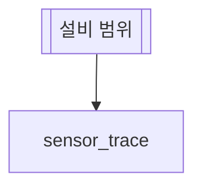
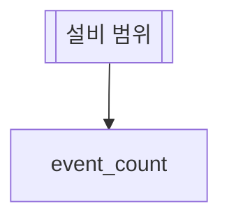
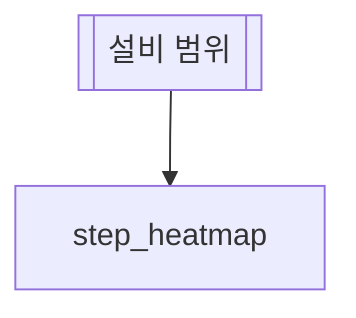

# fdc-chart

FDC 에이전트 md 의 조회 항목에 그래프 정의 하나를 적는 스킬이다.
그래프 정의는 조회 항목 안의 **chart 펜스**(```` ```chart ````)다.
BE 는 그 조회의 결과 표에 chart 펜스의 내용을 `chart` 칸으로 붙여 FE 로 보낸다. FE 는 그 칸으로 그래프를 그린다.

근거 파일(BE 레포 [ollybaysion/fdc-agent-be-spring](https://github.com/ollybaysion/fdc-agent-be-spring),
BE #203 · 계약 v1.33, 2026-10-28 머지):

- `src/main/java/fdc/agent/knowledge/tools/markdown/ChartFence.java`: 펜스 줄 읽기 · 키 · 필수 키 · bins 범위 · 열 검사.
- `src/main/java/fdc/agent/knowledge/tools/markdown/SkillMarkdownTool.java`: 펜스 자리(SQL 항목) · 펜스 둘 거부.
- `src/main/java/fdc/agent/knowledge/tools/flow/FlowError.java`: 오류 코드 `CHART_*` · 거부 글.
- `src/main/java/fdc/agent/common/domain/Chart.java`: 읽은 그래프(`kind` · `x` · `y[]` · `series[]` · `facet` · `value` · `bins` · `title`).
- `contract/openapi.json` 의 `Chart`: 결과 표의 `chart` 칸.
- 표본: `src/test/resources/chart/sensor-trend.md` · 테스트 `ChartFenceTest`.

BE 문서 `docs/skill-md.md` 의 그래프 절은 BE 문서 PR 이 쓴다. 이 스킬과 그 절이 다르면 BE 코드가 원본이다.

다른 스킬과 나누기:

| 할 일 | 스킬 |
| --- | --- |
| 조회 항목에 그래프(chart 펜스)를 적고 검사한다 | 이 스킬 |
| 에이전트 md 전체 · 플로우 펜스 · SQL 항목 · AKG 등록 | [`fdc-agent-md`](../fdc-agent-md/SKILL.md) |
| AKG md 의 설명 그림(mermaid) | [`akg-mermaid`](../akg-mermaid/SKILL.md) |

## 1. 언제 쓰나

조회 결과를 표와 함께 그래프로도 보여야 할 때 쓴다.

- 시계열 trace: 센서 값의 시간 추이. 행이 수천 개라서 표로는 추세와 이상치가 묻힌다.
- 이벤트 수: 종류별 · 설비별 · 시간대별 건수.
- 파라미터 상관: 두 값의 관계(예: RF 전력 × 식각 속도).
- 센서 × 시간: 범주 둘의 칸마다 값 하나(예: 센서 × 1분 칸의 편차).

규칙: **조회 항목 하나에 그래프 하나**다.
그 조회가 설비마다 표를 따로 내면 그 표들은 모두 같은 그래프 정의를 가진다.
그래프가 둘 필요하면 조회 항목을 둘로 나눈다.

## 2. 문법

### 자리

1. `## 데이터` 절의 SQL 항목(`### id — 제목` + ```` ```sql ```` 펜스) 안에 둔다.
2. sql 펜스 바로 뒤에 둔다. BE 는 sql 펜스 앞에 둔 chart 펜스도 읽는다.
3. 항목 하나에 chart 펜스 하나를 둔다.
4. 여는 줄은 줄 맨 앞에 ```` ```chart ```` 만 쓴다. 닫는 줄은 ```` ``` ```` 다.
5. 그래프 설명은 펜스 밖의 항목 본문 글에 쓴다.

````markdown
### sensor_trace — 센서 트렌드

```sql
select ts, snsr_id, snsr_type_cd, value from fdc_trace
where eqp_id = :eqp_id and ts between :start_time and :end_time
```

```chart
kind   = line
x      = ts
y      = value
series = snsr_id
facet  = snsr_type_cd
```
````

### 줄

꼴은 map 펜스와 같은 `키 = 값` 이다.

1. 한 줄에 `키 = 값` 하나를 쓴다.
2. `=` 앞뒤 공백 수는 자유다. 줄 맞춤 공백도 된다.
3. 빈 줄은 BE 가 건너뛴다.
4. 키는 소문자로 쓴다. BE 는 키의 대소문자를 가리지 않는다.
5. 한 키는 한 줄에 한 번만 쓴다.
6. 열 여럿은 한 줄에 쉼표로 쓴다: `series = snsr_id, chamber_id`. 빈 조각은 BE 가 뺀다.

### 키 여덟

| 키 | 값 | 필수 | 적지 않으면 | 뜻 |
| --- | --- | --- | --- | --- |
| `kind` | 종류 아홉 가운데 하나(3절) | 필수 | — | 그래프 종류 |
| `x` | 열 하나 | 필수 | — | x 축 열. histogram 은 분포를 볼 값 열, box 는 상자를 가르는 범주 열 |
| `y` | 열 하나, 또는 쉼표로 여럿 | heatmap · histogram 밖은 필수 | 빈 목록 | y 축 열. 열 여럿이면 열마다 선(막대) 하나. heatmap 은 행 범주 열 |
| `series` | 열 하나, 또는 쉼표로 여럿 | 선택 | 선 하나 | 선(묶음)을 가르는 범주 열. 값 조합마다 선 하나 |
| `facet` | 열 하나 | 선택 | 그래프 하나 | 값마다 작은 그래프 칸 하나로 가르는 열 |
| `value` | 열 하나 | heatmap 은 필수 | — | heatmap 의 칸 색 값 열 |
| `bins` | 정수 1~200 | 선택 | histogram 은 20 | histogram 의 구간 수 |
| `title` | 글 | 선택 | 조회 항목 제목 | 카드 · 서랍의 그래프 제목 |

- 필수 키의 값을 비우면(`x =`) 키가 없는 것과 같다.
- `kind` 를 빼거나 모르는 종류를 쓰면 BE 는 `y` · `value` 의 필수 검사를 그 종류를 고친 다음 판에 한다.
- `bins` 는 histogram 에 쓴다. 다른 종류에 적으면 BE 는 그 값을 `chart` 에 그대로 싣는다.

### 열 이름

1. 열 이름은 조회 SQL 의 select 열 이름이다. 별칭이 있으면 별칭이다.
2. BE 는 열 이름의 대소문자를 가리지 않는다(바인드 변수와 같은 규칙).
3. `x` · `facet` · `value` 에는 열 하나만 쓴다.
4. 식 열에는 별칭을 단다: `count(*) as cnt` · `avg(value) as avg_value`.

BE 는 `x` · `y` · `series` · `facet` · `value` 의 열마다 그 열이 select 열에 있는지 본다(`CHART_COLUMN`, 5절).
select 열을 읽을 수 있는 SQL 에서만 본다.
`select *` 나 별칭 없는 식이 있는 SQL 에서는 열 검사를 건너뛴다. 그때 BE 는 등록할 때 warn 로그 한 줄을 남긴다:
`스킬 <md> 조회 <id> 의 chart 열을 검사하지 않는다 — 문장의 출력 열을 읽지 못했다(select * 등)`.
그래서 select 열을 다 적고 식에 별칭을 단다. 그러면 열 이름 실수를 등록 전에 잡는다.

## 3. 종류 아홉 고르기

예는 FDC 데이터다(시안 Artifact PmUg2BuMNHazxoKKNFU4PZ 의 "종류 모음" 절).

| 종류 | 어떤 데이터 | 필수 키 | 예 |
| --- | --- | --- | --- |
| `line` | 시간 추세. 센서 trace | `x` · `y` | `x = ts` · `y = value` · `series = snsr_id`: TEMP-01 · TEMP-02 의 1 시간 trace, 1 초 간격 |
| `step` | 상태 · 이벤트 변화. 값이 다음 변화까지 이어진다 | `x` · `y` | `x = ts` · `y = state_cd`: 설비 상태 RUN · IDLE · DOWN · PM |
| `area` | 누적 영역. 묶음마다 값을 쌓는다 | `x` · `y` | `x = ts` · `y = flow_sccm` · `series = gas_cd`: 가스 Ar · CF4 · O2 유량 |
| `bar` | 범주별 수. `series` 가 있으면 묶음 막대 | `x` · `y` | `x = eqp_id` · `y = cnt` · `series = event_type`: 식각 설비 넷의 오늘 SETUP · ALARM 건수 |
| `stacked-bar` | 구성. 범주 안의 몫을 쌓는다. `series` 로 쌓을 범주를 준다 | `x` · `y` | `x = hour` · `y = alarm_cnt` · `series = alarm_level`: 시간대별 알람 INFO · WARN · CRIT |
| `scatter` | 두 값의 상관 | `x` · `y` | `x = rf_fwd_avg` · `y = etch_rate` · `series = chamber_id`: 웨이퍼 160 장의 RF 전력과 식각 속도 |
| `histogram` | 값 하나의 분포. `bins` 로 구간 수를 준다 | `x` | `x = etch_rate` · `bins = 20`: 웨이퍼 160 장의 식각 속도 분포 |
| `heatmap` | x × y 범주 칸에 `value` 색 | `x` · `value`. `y` 도 쓴다 | `x = ts_min` · `y = snsr_id` · `value = dev_sigma`: 센서 8 × 1 분 칸의 최대 편차(σ) |
| `box` | 범주마다 값의 분포 상자 | `x` · `y` | `x = chamber_id` · `y = value`: 챔버 넷의 TEMP 분포, 챔버마다 600 점 |

`kind` 는 표의 글자대로 소문자로 쓴다. 쌓은 막대는 `stacked-bar` 다.

고르는 순서:

1. x 가 시간인가? 그러면 `line` 이다. 값이 계단처럼 바뀌는 상태 열이면 `step` 이다. 합을 같이 보려면 `area` 다.
2. x 가 범주이고 y 가 건수 · 합인가? 그러면 `bar` 다. 범주 안의 구성을 보려면 `stacked-bar` 다.
3. 두 숫자 열의 관계를 보는가? 그러면 `scatter` 다.
4. 숫자 열 하나가 어디에 몰렸는지 보는가? 범주가 없으면 `histogram`, 범주마다 보려면 `box` 다.
5. 범주 둘의 칸마다 숫자 하나인가? 그러면 `heatmap` 이다.

## 4. 센서 여럿

센서가 여럿인 표는 센서가 행으로 오는지, 열로 오는지 먼저 본다.

| 표의 꼴 | 쓰는 키 | 그래프 |
| --- | --- | --- |
| 센서가 행으로 온다(`ts, snsr_id, value`) | `series = snsr_id` | 센서마다 선 하나 |
| 센서와 챔버 조합이 행으로 온다 | `series = snsr_id, chamber_id` | 값 조합마다 선 하나. 범례 글은 `FLOW-01 · CH1` 꼴(시안) |
| 단위가 다른 센서가 섞였다(FLOW 는 L/min, TEMP 는 ℃) | `facet = snsr_type_cd` 를 더한다 | 센서 종류마다 작은 그래프 칸 하나. 칸들은 x 축(시간)을 같이 쓴다 |
| 센서가 열로 온다(`ts, temp_01, temp_02`) | `y = temp_01, temp_02` | 열마다 선 하나 |

- 선 수는 SQL 의 where 로 줄인다. 시안의 시리즈 색은 여덟이다. 조합이 여덟을 넘으면 FE 가 범례를 줄인다(FE PR 뒤 확인).
- `facet` 은 열 하나다. 칸이 여럿이면 칸마다 y 축과 단위를 따로 둔다(시안).

아래 표본 셋은 2026-10-28 BE origin/main(b3d94ec, BE #203 머지)의 `scripts/check-flow` 로 `OK` 다.
셋 다 공통 md `eqp-scope` 가 `:eqp_id` · `:start_time` · `:end_time` 을 채운다.

### 표본 하나: 센서 trace(line + series + facet)

````markdown
# 센서 트렌드 에이전트

## 한 줄 설명

설비 센서 값의 시간 추이를 센서 종류별 그래프로 본다.

## 언제 호출되는가?

이 설비 센서 값이 지난 한 시간 동안 어떻게 움직였는지 보고 싶다.

## 데이터



### sensor_trace — 센서 트렌드

센서마다 값을 시간 순으로 본다. 단위가 다른 센서는 종류마다 칸을 가른다.

```sql
select ts, snsr_id, snsr_type_cd, value from fdc_trace
where eqp_id = :eqp_id and ts between :start_time and :end_time
```

```chart
kind   = line
x      = ts
y      = value
series = snsr_id
facet  = snsr_type_cd
```
````

`title` 이 없어서 그래프 제목은 항목 제목 "센서 트렌드" 다.

### 표본 둘: 이벤트 수(bar)

````markdown
# 이벤트 수 에이전트

## 한 줄 설명

설비 이벤트를 종류별로 세어 막대로 본다.

## 언제 호출되는가?

이 설비에 오늘 어떤 이벤트가 몇 번 났는지 보고 싶다.

## 데이터



### event_count — 이벤트 종류별 수

```sql
select event_type, count(*) as cnt from eqp_event
where eqp_id = :eqp_id and ts between :start_time and :end_time
group by event_type
```

```chart
kind  = bar
x     = event_type
y     = cnt
title = 이벤트 종류별 건수
```
````

`count(*)` 에 별칭 `cnt` 를 달았다. 그래서 BE 가 `y = cnt` 의 열 검사를 한다.

### 표본 셋: 스텝 × 센서(heatmap)

````markdown
# 스텝 편차 에이전트

## 한 줄 설명

레시피 스텝마다 센서 평균을 칸 색으로 본다.

## 언제 호출되는가?

어느 스텝에서 어느 센서가 튀었는지 한눈에 보고 싶다.

## 데이터



### step_heatmap — 스텝별 센서 평균

```sql
select step_id, snsr_id, avg(value) as avg_value from fdc_trace
where eqp_id = :eqp_id and ts between :start_time and :end_time
group by step_id, snsr_id
```

```chart
kind  = heatmap
x     = step_id
y     = snsr_id
value = avg_value
title = 스텝 × 센서 평균
```
````

## 5. 검사

### BE: scripts/check-flow

BE 체크아웃의 `scripts/check-flow` 가 등록 때와 같은 chart 검사를 돈다.
준비(`FDC_BE` · JDK 21)와 출력 꼴 · 끝 코드는 [`fdc-agent-md`](../fdc-agent-md/SKILL.md) 9절과 같다.
BE 체크아웃은 BE #203 이 든 origin/main 에 맞춘다.

```bash
JAVA_HOME=~/tools/jdk-21.0.11+10 "$FDC_BE/scripts/check-flow" 에이전트.md [같이 쓰는 md …]
```

출력 예(2026-10-28 BE origin/main 으로 돌린 줄 그대로):

```text
OK sensor-trend.md
chart-bad.md:19 CHART_KIND 모르는 종류 pie — 받는 종류는 line · step · area · bar · stacked-bar · scatter · histogram · heatmap · box
chart-bad.md:21 CHART_COLUMN y 열 val 이 조회 trend 의 출력 열에 없다 — 출력 열은 TS · SNSR_ID · VALUE
chart-bad.md:22 CHART_KEY 모르는 키 colour — 받는 키는 kind · x · y · series · facet · value · bins · title
chart-bad2.md:17 CHART_REQUIRED value 가 없다 — heatmap 은 색 값 열을 적는다
chart-bad2.md:21 CHART_KEY 키 x 가 두 번 나온다
chart-dup.md:23 CHART_DUPLICATE 항목 trend 에 chart 펜스가 2 개다 — 하나만 둔다
```

- 줄은 md 파일의 줄이다. 각 오류는 그 키의 줄을 가리킨다.
- 키가 아예 없는 `CHART_REQUIRED` 는 chart 펜스를 여는 줄을 가리킨다.
- 출력 열 목록은 대문자로 보인다. 열 맞춤은 대소문자를 가리지 않는다. 그래서 `y = Value` 는 통과한다.
- BE 는 chart 오류가 있는 첫 조회 항목에서 그 md 읽기를 멈춘다. 그래서 한 md 에서 오류 항목 하나의 줄만 나온다.
  그 항목을 고친 뒤 다시 돌린다. 다음 항목의 오류가 그때 나온다.
- `CHART_DUPLICATE` 가 나오면 펜스를 하나로 줄인 뒤 다시 돌린다. 남긴 펜스의 검사는 그때 돈다.
- 플로우 펜스(mermaid)에 문법 오류가 있으면 check-flow 는 그 파일의 chart 검사를 플로우 오류를 고친 다음 판에 한다.

### AKG 저장 검사

AKG 는 저장할 때 BE 와 같은 검사를 돈다([`fdc-agent-md`](../fdc-agent-md/SKILL.md) 10절).
chart 검사는 AKG PR(`feat/chart-check`)이 맡는다. 그 PR 은 BE 와 같은 코드 여섯을 낸다.
**미확인**(2026-10-28): 그 PR 은 AKG 워크트리 `feat/chart-check` 에서 진행 중이다. 코드 이름과 응답 꼴(400 `validation_failed` 의 `details[]` 인지)은 그 PR 이 정한다.
그때까지 chart 펜스는 BE check-flow 로 검사한다.
fdc-agent-md 9절의 AKG node 한 줄(`src/flow/agent-md.mjs`)도 그 PR 뒤에 chart 펜스를 본다(미확인).

### 오류 코드 여섯

| 코드 | 언제 | 가리키는 줄 | 고치는 법 |
| --- | --- | --- | --- |
| `CHART_KIND` | `kind` 가 종류 아홉 밖이다(예: `pie`) | `kind` 줄 | 3절 표의 종류 하나로 바꾼다 |
| `CHART_KEY` | 모르는 키(예: `colour`) · 같은 키를 두 번 썼다 · `키 = 값` 꼴이 아닌 줄 | 그 줄 | 2절의 키 여덟만 쓴다. 한 키는 한 줄에 쓰고, 열 여럿은 그 줄에 쉼표로 쓴다. 설명 글은 펜스 밖에 둔다 |
| `CHART_REQUIRED` | 필수 키가 없거나 값이 비었다. 사유가 키를 밝힌다 | 그 키 줄. 키가 없으면 펜스를 여는 줄 | 사유의 키를 쓴다. `kind` · `x` 는 늘, `y` 는 heatmap · histogram 밖, `value` 는 heatmap |
| `CHART_COLUMN` | 열이 조회의 select 열에 없다. 사유 끝에 select 열 목록이 있다 | 그 키 줄 | 목록의 이름으로 고친다. 목록에 없는 열이 필요하면 SQL select 에 그 열이나 별칭을 더한다 |
| `CHART_BINS` | `bins` 가 1~200 의 정수가 아니다(`0` · `500` · `2.5` · `abc`) | `bins` 줄 | 1~200 의 정수를 쓴다. 기본 20 이면 줄을 지운다 |
| `CHART_DUPLICATE` | 조회 항목 하나에 chart 펜스가 둘 이상이다 | 둘째 펜스부터 펜스마다 여는 줄 | 펜스 하나만 남긴다. 그래프가 둘 필요하면 조회 항목을 둘로 나눈다 |

### 거부 글

BE 는 chart 오류가 있는 md 를 읽을 때 거부한다. BE 는 그 md 를 에이전트 목록에서 뺀다.
처리는 fdc-agent-md 4절의 "md 를 읽을 때" 거부와 같다(AKG md 는 로그 `akg domain-skill <id> 수용 불가 — 제외`).
거부 글의 꼴은 다음과 같다. `이름` 은 md 이름이고, `N` 은 md 파일의 줄이다. 오류 여럿은 `;` 로 잇는다.

```text
이름: 그래프 펜스 오류로 거부 — N 번째 줄 CODE 사유; N 번째 줄 CODE 사유
```

예(`ChartFenceTest` 의 글. 펜스는 `kind = line` · `color = red` · `bins = 0` 세 줄이고, 11 번째 줄은 펜스를 여는 줄이다):

```text
g: 그래프 펜스 오류로 거부 — 11 번째 줄 CHART_REQUIRED x 가 없다; 11 번째 줄 CHART_REQUIRED y 가 없다 — line 는 y 열을 적는다; 13 번째 줄 CHART_KEY 모르는 키 color — 받는 키는 kind · x · y · series · facet · value · bins · title; 14 번째 줄 CHART_BINS bins 는 1~200 의 정수다: 0
```

### 절차

1. 1절로 그래프가 필요한 조회 항목을 고른다.
2. SQL 의 select 열을 다 적는다. 식 열에는 별칭을 단다.
3. 3절 표로 종류를 고른다.
4. sql 펜스 뒤에 chart 펜스를 쓴다. `kind` 와 필수 키를 먼저 쓴다.
5. 센서가 여럿이면 4절로 `series` · `facet` 을 더한다.
6. check-flow 를 돌린다.
7. 오류 줄을 오류 코드 표대로 고친다.
8. `OK` 가 나올 때까지 6~7 을 되풀이한다.
9. fdc-agent-md 10절대로 AKG 에 올린다.

## 6. 화면에서 보이는 모양

FE 는 진행 중이다. 이 절은 시안 2안(Artifact PmUg2BuMNHazxoKKNFU4PZ)이다. **FE PR 뒤** 실제 화면으로 고친다.

BE 몫(계약 v1.33, BE #203 머지):

- 조회로 만든 결과 표가 `chart` 칸을 가진다. 칸은 2절의 키 여덟이고, `kind` 는 md 의 글자 그대로 소문자다.
- 표를 FE 로 싣는 자리(표 이벤트 · `done` 의 표 · 앞 턴 표 되보내기 · 디버그 기록)가 같은 칸을 쓴다.
- 설비 · 바인드 값으로 갈린 표는 모두 같은 `chart` 를 가진다.

FE 몫(FE PR 뒤):

1. 답 아래에 채팅 그래프 카드가 선다. 카드는 머리 한 줄(그래프 제목) · 그래프 · 발 한 줄(범례)이다.
   카드 폭은 채팅 목록 폭의 85% 다. `facet` 칸은 카드에서 가로로 선다. 칸이 많으면 앞 칸 몇 개와 "외 m" 으로 줄인다.
2. 카드를 누르면 오른쪽 서랍(폭 900)이 열린다.
3. 서랍은 큰 그래프 오른쪽에 조작 열을 둔다. 조작 열에서 다음을 한다:
   - 시리즈 켜고 끄기.
   - 기간을 끌어 확대하기.
   - 표 보기로 바꾸기. 표 보기는 지금 표 서랍의 전체 표를 쓴다.
   - 이상치로 가기. 시안은 이상치를 평균 ± 4σ 로 센다.
4. 서랍에서 `facet` 칸은 세로로 쌓인다. 칸들은 x 축(시간)을 같이 쓴다.
5. 그래프는 uPlot 으로 그린다(시안 추천).
