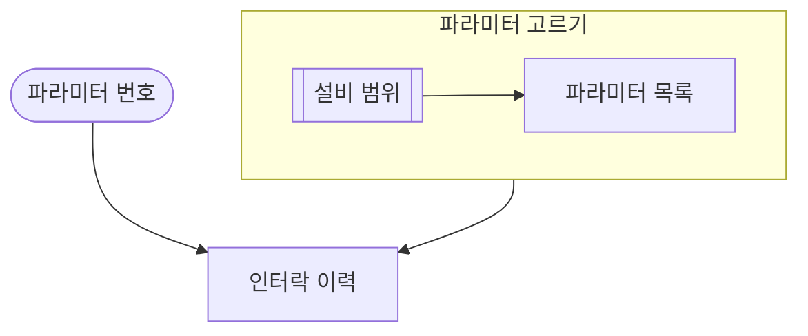
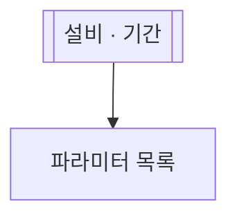
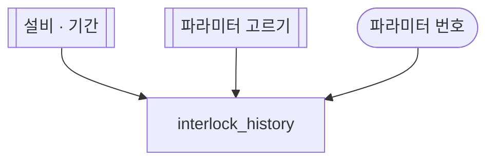

# fdc-flowchart

FDC 에이전트 md 의 **플로우 펜스**를 쓰는 쪽이다. 플로우 펜스는 `## 데이터` 아래의 mermaid
펜스다. BE 가 이 펜스를 실행 그래프로 컴파일한다. 그래서 펜스의 줄 하나하나가 BE 문법을 따른다.

근거 파일(BE 레포 [ollybaysion/fdc-agent-be-spring](https://github.com/ollybaysion/fdc-agent-be-spring),
로컬 체크아웃 `~/work/fdc-agent/fdc-agent-be`):

- `docs/skill-md.md` 의 "조회 흐름" 절: 노드 · 간선 · 검사 · 공통 md.
- `src/main/java/fdc/agent/knowledge/tools/flow/FlowGrammar.java`: 줄 정규식 전부.
- `FlowCompiler.java`: 노드 종류 정하기. `FlowRules.java`: 뜻 검사. `FlowError.java`: 오류 코드.

## 1. 언제 쓰나 · 다른 스킬과 나누기

| 할 일 | 스킬 |
| --- | --- |
| 에이전트 md 의 `## 데이터` 플로우 펜스를 쓰고 고친다. BE 가 실행한다 | 이 스킬 |
| AKG md 의 설명 그림(실행하지 않는 그림)을 쓴다 | [`akg-mermaid`](../akg-mermaid/SKILL.md) |
| 다 쓴 md 를 AKG 에 올린다 | [`akg-push`](../akg-push/SKILL.md) |

akg-mermaid 의 일반 규칙과 BE 문법이 부딪치면 이 스킬은 BE 문법을 따른다. 부딪치는 곳은 4절 끝에 있다.

## 2. 자리

1. `## 데이터` 제목 아래에 둔다.
2. 첫 `###` 항목 앞에 둔다.
3. 펜스는 md 하나에 하나다. BE 는 둘이면 등록을 거부한다(`mermaid 펜스는 하나다`).
4. 펜스 첫 줄은 `flowchart TD` 다. 가로로 그리려면 `flowchart LR` 이다.

`:var` 를 쓰는 SQL 항목이 있으면 펜스가 있어야 한다. 펜스가 없으면 BE 가 등록을 거부한다.
펜스에 플로우 오류가 있으면 BE 가 그 md 의 등록을 거부한다.
그래서 올리기 전에 7절의 `scripts/check-flow` 를 꼭 돌린다.

## 3. 노드 셋 + subgraph

규칙 하나: **노드 id 는 가리키는 것의 이름이다.**

| 노드 | 모양 | id 는 무엇 | id 표기 | 글 |
| --- | --- | --- | --- | --- |
| 입력 | `id([글])` | SQL 바인드 변수 이름(`:id` 의 `id`) | `[A-Za-z][A-Za-z0-9_]*`, `_` | 카드 물음이자 서랍 제목 |
| 조회 | `id[글]` | `### id — 제목` 의 id. 다른 md 의 조회 id 도 된다 | `_` | 사람용 제목 |
| 플로우 | `id[[글]]` | 등록된 md 이름 또는 subgraph id | md 이름은 `-`, subgraph id 는 `_` | 사람용 제목 |
| subgraph | `subgraph id [글]` … `end` | 이 펜스 안 플로우 하나의 이름 | `[a-z][a-z0-9_]*`, `_` | 사람용 제목. 꼭 적는다 |

- 모양은 노드 줄에 적는다. 간선 줄의 끝에 같이 적어도 된다: `eqp-scope[[설비 범위]] --> param_list[파라미터 목록]`.
- **같은 id 는 한 모양으로 적는다.** 한 번 모양을 적은 id 는 그 뒤에 id 만 써도 된다.
- 어느 줄에도 모양을 적지 않은 id 는 조회로 본다.
- md 이름의 `-` 는 글자 사이에 하나씩 둔다. 첫 `-` 앞 낱말은 mermaid 낱말 밖에서 고른다
  (`end` · `style` · `class` · `click` · `subgraph` · `direction` · `graph` · `flowchart` 는 머리에 쓸 수 없다).
- 다른 md 의 조회를 조회 노드로 쓰면 그 조회가 이 에이전트의 요청에 더해진다.
- 공통 입력(라인 · 설비 · 기간)은 공통 md `eqp-scope` 가 적는다. 에이전트 md 는
  `eqp-scope[[설비 범위]]` 를 caller 로 세운다.

subgraph:

1. `subgraph id [글]` 줄로 열고 `end` 줄로 닫는다.
2. 안쪽에는 노드 줄 · 간선 줄을 바깥과 같은 문법으로 쓴다.
3. 노드는 처음 나온 subgraph 에 든다. 한 노드는 subgraph 하나에만 든다.
4. subgraph 안에 subgraph 를 두지 않는다. subgraph 는 한 단이다.
5. subgraph id 는 등록된 md 전체에서 하나뿐인 이름이다. 같은 md 의 조회 id · 입력 id ·
   다른 subgraph id · 등록된 md 이름과 다르게 짓는다.
6. 같은 md 안에서는 subgraph id 를 간선 끝에 바로 쓴다: `param_pick --> interlock_history`.
7. 다른 md 에서는 플로우 노드로 적는다: `param_pick[[파라미터 고르기]]`.
   그 md 에는 그 subgraph 안의 노드만 실린다.

에이전트 md 자신을 돌릴 때는 펜스 전체가 돈다. subgraph 는 묶음 이름이다.

## 4. 간선

| 화살표 | 뜻 |
| --- | --- |
| `a --> b` | `a` 의 값이 `b` 로 간다 |
| `a -->\|조건\| b` | 조건에 맞는 행만 `b` 로 간다. caller `a` 가 조회일 때만 쓴다 |
| `a -.-> b` | 선택 입력이다. 입력 → 조회에만 쓴다. 입력이 비면 `b` 와 `b` 뒤 조회를 건너뛴다. 카드로 묻지 않는다 |

받는 조합(caller → callee):

| caller | callee | 뜻 |
| --- | --- | --- |
| 입력 | 조회 | 그 조회의 같은 이름 `:var` 를 그 입력이 채운다. `-->` 또는 `-.->` |
| 플로우 | 조회 | 앞에 선 플로우다. 그 플로우의 입력 노드와 끝 조회(나가는 간선이 없는 조회)의 열이 같은 이름으로 흘러든다 |
| 조회 | 조회 | callee 는 caller 의 표를 기다린다. 조건 라벨을 쓸 수 있다 |
| 조회 | 플로우 | 맞는 행이 있으면 그 플로우를 얹는다. 그 플로우의 시작 조회를 맞는 행의 값으로 채운다. 조건 라벨을 쓸 수 있다 |

간선 줄 규칙:

- 한 줄에 간선 하나를 쓴다. `a --> b --> c` 는 두 줄로 나눈다.
- `&` 는 쓰지 않는다. 화살표는 `-->` 와 `-.->` 둘이다.
- 간선 끝에 모양을 같이 적을 수 있다. 그 id 의 다른 줄과 같은 모양으로 적는다.

조건 라벨은 넷이다.

| 라벨 | 맞는 행 |
| --- | --- |
| `\|col = 'v'\|` | `col` 값이 `v` 인 행 |
| `\|col != 'v'\|` | `col` 값이 `v` 가 아닌 행. 빈 칸도 맞는다 |
| `\|col in ('a', 'b')\|` | `col` 값이 목록에 있는 행 |
| `\|else\|` | 그 caller 의 다른 조건에 맞지 않은 행. caller 마다 하나 |

- `col` 은 caller 조회의 select 열이다. 대소문자는 가리지 않는다.
- 값은 작은따옴표로 싼다. 앞뒤 공백을 벗긴 글자 그대로 견준다.
- 한 행이 두 간선에 맞으면 두 callee 가 다 갖는다. 맞는 행이 없는 callee 는 돌지 않는다.

akg-mermaid 와 부딪치는 곳(2026-10-28, BE 정규식과 check.mjs 로 확인):

| 쓴 것 | BE | AKG 그림 | 이 스킬의 꼴 |
| --- | --- | --- | --- |
| 라벨을 큰따옴표로 쌈 `a["글"]` | 큰따옴표가 글에 남는다. 입력 노드는 `NODE_SYNTAX` | 그려진다 | 큰따옴표 없이 `a[글]` |
| 라벨 안 반각 괄호 `a([번호(숫자)])` | 입력 노드는 `NODE_SYNTAX`. 조회 · 플로우 노드는 받는다 | Parse error | 전각 괄호 `a([번호（숫자）])` 또는 괄호를 뺀 글 |
| `id[[글]]` | 플로우 노드 | 그려진다(subroutine 모양). check.mjs 는 `[[ ]]` 주의를 낸다 | 그대로 쓴다. 이 주의는 플로우 노드 줄이면 넘긴다 |
| 조건 `\|col in ('a', 'b')\|` | 받는다 | Parse error(라벨 안 괄호) | BE 꼴 그대로 쓴다. AKG 화면에는 그림 대신 오류가 보인다 |
| 노드 8 개 · 화살표 10 개 상한 | 상한 없음 | 넓으면 칸에 맞춰 준다 | SQL 항목이 정한 만큼 쓴다. 공통 부분은 subgraph 로 묶는다 |

`·` 는 큰따옴표 없이 그대로 쓴다. BE 와 AKG 둘 다 받는다.

## 5. 바인드 변수 출처

SQL 항목의 `:var` 마다 출처가 하나 있어야 한다. 출처는 그 조회로 들어오는 간선의 caller 다.

| 출처 | 채우는 `:var` |
| --- | --- |
| 입력 노드 `var([글])` | 같은 이름의 `:var` |
| caller 조회 | caller 의 select 열 가운데 같은 이름의 `:var`. 설비 바인드는 뺀다(아래) |
| caller 플로우(md · subgraph) | 그 플로우의 입력 노드 이름과 끝 조회의 열 이름. 그 플로우가 앞에 세운 플로우의 이름도 |

- 이름은 대소문자를 가리지 않는다.
- `:start_time` · `:end_time` 은 입력 `duration` 하나가 채운다. 값이 없으면 기간 카드 하나로 묻는다.
- 설비 바인드(`:eqp_id` · `:equipment` · `:eqp`)는 입력 `eqp_id` 가 채운다. caller 조회의 열로만 채우면
  `UNSUPPORTED_EQP_FLOW` 다.
- 설비 · 라인 · 기간은 공통 md `eqp-scope[[설비 범위]]` 를 caller 로 세워 받는다.

목록에서 하나를 고르게 하려면:

1. 목록 조회를 caller 로, 고른 값을 쓰는 조회를 callee 로 잇는다(조회 → 조회 간선).
2. callee 의 `:var` 와 같은 이름의 열을 목록 조회의 select 에 둔다.
3. BE 는 목록 표의 행 수로 정한다. 1 행이면 그 값으로 돈다. 2 행이면 행마다 돈다.
   3 행 이상이면 행 고르기 카드를 낸다. 고른 행으로 다음 조회가 돈다.
4. 사람이 값을 바로 적을 수도 있게 하려면 같은 이름의 입력 노드도 callee 로 잇는다.

선택 입력: `-.->` 로 이은 입력이 비면 그 조회는 건너뛴다. SQL 은 평범한 `col = :x` 로 쓴다.

## 6. 쓰는 순서

1. SQL 항목마다 `:var` 를 적는다.
2. SQL 항목마다 select 열을 적는다.
3. `:var` 마다 5절에서 출처 하나를 고른다.
4. 펜스 첫 줄 `flowchart TD` 를 쓴다.
5. 노드마다 모양과 글을 적는다. 노드 줄에 적거나 간선 줄 끝에 같이 적는다.
6. 간선 줄을 쓴다. 같은 id 는 줄마다 같은 모양으로 적는다.
7. 조건이 있는 조회 → 조회 · 조회 → 플로우 간선에 조건 라벨을 단다.
8. 여러 조회가 같이 쓰는 앞부분은 subgraph 로 묶는다. 다른 md 도 쓰면 subgraph 를 그 md 에서 `[[ ]]` 로 가리킨다.
9. 7절의 검사 둘을 돌린다. check-flow 오류가 있는 md 는 BE 가 등록을 거부한다.
10. 오류가 없으면 [`akg-push`](../akg-push/SKILL.md) 로 올린다.

## 7. 검사

### BE 규칙: scripts/check-flow

BE 체크아웃의 `scripts/check-flow` 가 펜스를 검사한다.
검사 규칙은 BE 와 같은 `FlowGrammar` · `FlowCompiler` · `FlowRules` 다.
BE 체크아웃 경로는 `FDC_BE` 로 준다. 기본은 `~/work/fdc-agent/fdc-agent-be` 다.

```bash
FDC_BE="${FDC_BE:-$HOME/work/fdc-agent/fdc-agent-be}"
JAVA_HOME=~/tools/jdk-21.0.11+10 "$FDC_BE/scripts/check-flow" 에이전트.md [같이 쓰는 md …]
```

- 파일 이름(확장자 뺌)이 md 이름이다. 플로우 노드가 가리키는 md(`eqp-scope.md` 등)를 같이 넘긴다.
- 출력은 오류마다 한 줄이다: `파일:줄 코드 글`. 줄은 md 파일의 줄이다. 뜻 검사의 오류는 줄이 0 이다.
- 오류가 없는 파일은 `OK` 줄 하나다.
- 끝 코드 0 은 모두 OK, 1 은 오류 있음, 2 는 준비 문제(파일 · JDK)다.

scripts/check-flow 는 BE subgraph PR 이 main 에 머지된 뒤 BE main 에 있다.

### AKG 그림: check.mjs

[`akg-mermaid`](../akg-mermaid/SKILL.md) 의 `check.mjs` 가 AKG 와 같은 mermaid 로 펜스를 그린다.

```bash
node "<akg-mermaid 스킬 폴더>/check.mjs" 에이전트.md
```

- `FAIL` 줄은 AKG 화면에서 그림 대신 오류가 보이는 펜스다. 4절 끝 표대로 고친다.
- 플로우 노드 줄의 `[[ ]]` 주의는 넘긴다.

## 8. 오류 코드

check-flow 가 내는 코드다. 이름은 BE `FlowError.Code` 그대로다.

| 코드 | 뜻 | 고치는 꼴 |
| --- | --- | --- |
| `HEADER` | 첫 줄이 `flowchart TD` · `flowchart LR` 이 아니다 | 첫 줄을 `flowchart TD` 로 쓴다 |
| `DIRECTIVE` | `%%{…}%%` 지시문 | 지시문 줄을 지운다 |
| `RESERVED_WORD` | 줄이나 id 머리가 mermaid 낱말(`style` · `class` · `direction` …)이다. `subgraph` · `end` 줄은 받는다 | id 를 다른 낱말로 바꾼다. `style` · `classDef` 줄은 지운다 |
| `AMPERSAND` | `a & b --> c` | 간선을 줄마다 하나씩 쓴다 |
| `CHAIN` | `a --> b --> c` | `a --> b` · `b --> c` 두 줄로 나눈다 |
| `ARROW` | `---` · `==>` · `--o` 같은 화살표 | `-->` 또는 `-.->` 로 쓴다 |
| `EDGE_SYNTAX` | 간선 줄 꼴이 틀렸다 | `a --> b` · `a -->\|조건\| b` · `a -.-> b` 로 쓴다. 끝에 모양을 붙여도 된다 |
| `NODE_SYNTAX` | 노드 줄 꼴이 틀렸다. 흔히 입력 노드 글에 괄호 · 큰따옴표가 있다 | `id([글])` · `id[글]` · `id[[글]]` 로 쓴다. 괄호는 전각으로 |
| `CONDITION_SYNTAX` | 조건 라벨이 네 꼴 밖이다 | `col = 'v'` · `col != 'v'` · `col in ('a', 'b')` · `else` |
| `INPUT_ID` | 입력 id 가 바인드 이름 꼴이 아니다(`-` 가 들었다) | `_` 로 쓴다: `param_index` |
| `SHAPE_CONFLICT` | 같은 id 를 다른 모양으로 두 번 적었다(노드 줄 · 간선 줄 어디서든) | 모양 하나로 맞춘다 |
| `UNKNOWN_ID` | 조회 노드가 SQL 항목도 등록된 조회도 아니다. 또는 플로우 노드가 등록된 md 도 subgraph 도 아니다. md 이름을 `[[ ]]` 없이 쓴 경우도 이것이다 | id 를 `### id` 와 맞춘다. md 는 `md이름[[글]]` 로 쓴다 |
| `INPUT_IS_QUERY` | 입력 id 가 SQL 항목 id 와 같다 | 입력 id 를 바인드 이름으로 바꾼다 |
| `QUERY_IS_MD` | 조회 id 와 md 이름이 같다 | 조회 id 를 `_` 이름으로 바꾼다 |
| `SELF_FLOW` | 플로우 노드가 자기 md 를 가리킨다. 또는 subgraph 안에서 그 subgraph 를 플로우 노드로 적었다 | 그 노드를 지운다 |
| `FLOW_ALONE` | 플로우 노드가 간선에 없다 | 그 플로우를 caller 또는 callee 로 잇는다 |
| `EDGE_KIND` | 입력으로 들어가는 간선 · 입력 → 플로우 · 플로우 → 플로우 | 4절 받는 조합으로 고친다. 값은 조회로 보낸다 |
| `OPTIONAL_EDGE` | `-.->` 가 입력 → 조회가 아니다 | `-->` 로 바꾼다 |
| `CONDITION_PLACE` | 조건 라벨의 caller 가 조회가 아니다 | 라벨을 지우거나 caller 를 조회로 둔다 |
| `ELSE_DUPLICATE` | 한 caller 의 `else` 가 둘 이상이다 | `else` 를 하나만 둔다 |
| `CONDITION_COLUMN` | 조건 열이 caller 조회의 select 열에 없다 | 열을 select 에 더하거나 라벨 열 이름을 고친다 |
| `UNSOURCED_VAR` | 조회의 `:var` 를 채울 출처가 없다 | 5절의 출처 하나를 그 조회로 잇는다 |
| `UNSUPPORTED_EQP_FLOW` | `:eqp_id` 를 caller 조회의 열로만 채운다 | 입력 `eqp_id` 또는 `eqp-scope[[설비 범위]]` 를 잇는다 |
| `CYCLE` | 펜스 안 순환 | 간선 하나를 지워 한 방향으로 둔다 |
| `MD_CYCLE` | md 를 가로지르는 순환 | md 사이 플로우 노드 하나를 걷는다 |
| `SUBGRAPH_ID` | subgraph id 가 `[a-z][a-z0-9_]*` 가 아니다. 또는 `subgraph` 줄 꼴이 틀렸다 | `subgraph param_pick [글]` 로 쓴다. id 는 소문자와 `_` |
| `SUBGRAPH_TITLE` | `subgraph id [글]` 의 글이 없다 | `[글]` 을 적는다 |
| `SUBGRAPH_UNCLOSED` | `subgraph` 를 `end` 로 닫지 않았다 | 묶음 끝에 `end` 줄을 둔다 |
| `SUBGRAPH_END` | 연 `subgraph` 없이 `end` 가 나왔다 | 남는 `end` 줄을 지운다 |
| `SUBGRAPH_NESTED` | subgraph 안에 subgraph 를 열었다 | 안쪽 subgraph 를 바깥으로 꺼내 나란히 둔다 |
| `SUBGRAPH_MEMBER` | 다른 subgraph 에 든 노드를 이 subgraph 안 노드 줄로 또 적었다 | 노드 줄은 한 subgraph 에만 둔다. 다른 곳에서는 간선에 id 만 쓴다 |
| `SUBGRAPH_EMPTY` | 든 노드가 없는 subgraph | 노드 줄을 넣거나 subgraph 를 지운다 |
| `SUBGRAPH_ID_CLASH` | subgraph id 가 조회 id · 입력 id · 다른 subgraph id · 등록된 md 이름과 같다 | 하나뿐인 이름으로 바꾼다 |

## 9. 표본

### 좋은 표본 하나: 한 md 안 subgraph

파라미터를 고르는 앞부분을 subgraph `param_pick` 으로 묶는다. 인터락 이력 조회가 그 subgraph 를 caller 로 쓴다.

````markdown
## 데이터



### param_list — 파라미터 목록

```sql
select param_index, param_name from PARAM_INFO where eqp_id = :eqp_id
```

### interlock_history — 인터락 이력

```sql
select act_time, interlock_id from INTERLOCK_HIST where eqp_id = :eqp_id and param_index = :param_index and act_time between :start_time and :end_time
```
````

- `param_list` 의 `:eqp_id` 는 `eqp-scope` 의 입력 `eqp_id` 가 채운다.
- `interlock_history` 의 `:param_index` 는 입력 `param_index` 가 채운다.
  또는 `param_pick` 의 끝 조회 `param_list` 의 열이 채운다.
- `:eqp_id` · `:start_time` · `:end_time` 은 `param_pick` 이 앞에 세운 `eqp-scope` 가 채운다.
- 다른 md 는 `param_pick[[파라미터 고르기]]` 노드 줄과 `param_pick --> 내 조회` 간선으로 이 앞부분을 쓴다.

### 좋은 표본 둘: md 둘로 나눔

같은 앞부분을 md `param-pick` 으로 나눈 꼴이다.
BE 확인 테스트 `src/test/resources/split-md/` 의 두 파일 그대로다.

`param-pick.md` 의 `## 데이터`:

````markdown
## 데이터



### param_list — 파라미터 목록

```sql
select param_index, param_name from PARAM_INFO where eqp_id = :eqp_id
```
````

`interlock-history.md` 의 `## 데이터`:

````markdown
## 데이터



### interlock_history — 인터락 이력

```sql
select act_time, interlock_id from INTERLOCK_HIST where eqp_id = :eqp_id and param_index = :param_index and act_time between :start_time and :end_time
```
````

md 이름은 `-`(`param-pick`), subgraph id 는 `_`(`param_pick`)다. 표기로 둘이 갈린다.

### 흔한 실수와 고친 꼴

같은 id 를 두 모양으로 적었다 → `SHAPE_CONFLICT`. 입력 `param_index` 를 간선 끝에서 조회 모양으로 또 적었다.

```text
  param_index([파라미터 번호])
  param_index[파라미터 번호] --> interlock_history
```

```text
  param_index([파라미터 번호])
  param_index --> interlock_history
```

조회 → 입력 간선 → `EDGE_KIND`. 조회의 열은 callee 조회로 바로 간다.

```text
  param_list --> param_index
  param_index --> interlock_history
```

```text
  param_list --> interlock_history
  param_index --> interlock_history
```

md 이름에 `[[ ]]` 가 빠졌다 → `UNKNOWN_ID`.
메시지는 md 를 플로우 노드로 쓰려면 `eqp-scope[[글]]` 로 적으라고 알린다.
그 md 가 채우던 `:eqp_id` 도 출처를 잃어 `UNSOURCED_VAR` 가 같이 나온다.

```text
  eqp-scope[설비 범위]
```

```text
  eqp-scope[[설비 범위]]
```

선택 입력을 SQL 의 `is null` 꼴로 받는다. 검사는 지나간다. BE 는 빈 선택 입력의 조회를 건너뛰므로
`is null` 길은 돌지 않는다.

```text
select param_index from PARAM_INFO where eqp_id = :eqp_id and (:param_name is null or param_name = :param_name)
```

```text
select param_index from PARAM_INFO where eqp_id = :eqp_id and param_name = :param_name
```

그리고 펜스에 `param_name -.-> param_by_name` 간선을 둔다.

`:var` 출처가 없다 → `UNSOURCED_VAR`(`lot_history 의 :lot_id 를 채울 입력이 없다`).
`lot_history` 의 SQL 은 `where eqp_id = :eqp_id and lot_id = :lot_id` 다.

```text
  lot_history[로트 이력]
  eqp-scope --> lot_history
```

```text
  lot_id([로트 번호])
  lot_history[로트 이력]
  eqp-scope --> lot_history
  lot_id --> lot_history
```

입력 노드 글에 반각 괄호를 썼다 → BE `NODE_SYNTAX`, AKG 그림 Parse error.

```text
  param_index([파라미터 번호(숫자)])
```

```text
  param_index([파라미터 번호（숫자）])
```
